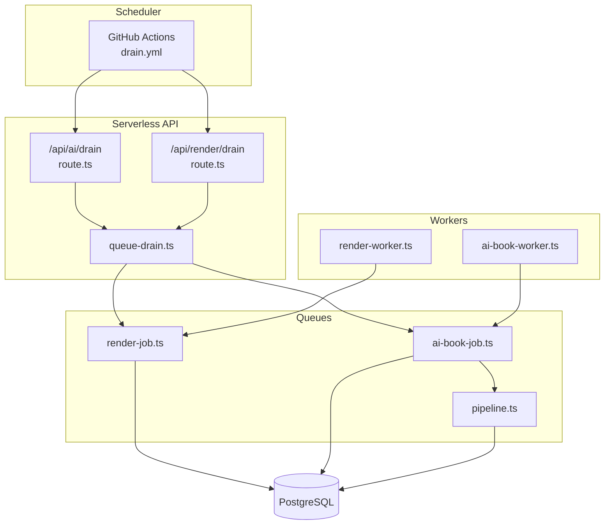
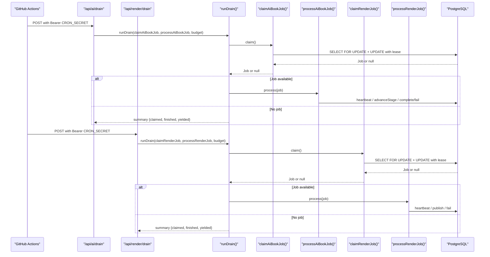
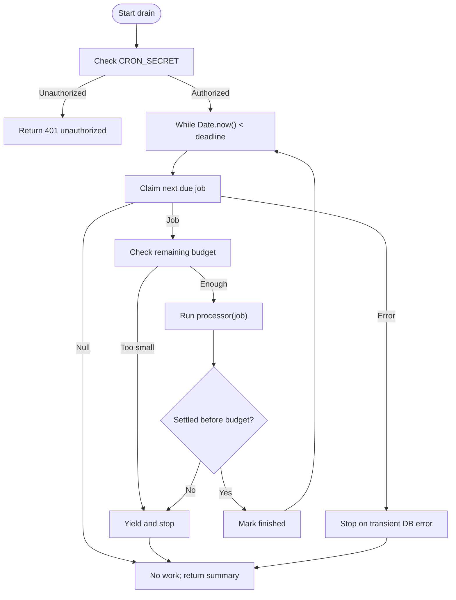
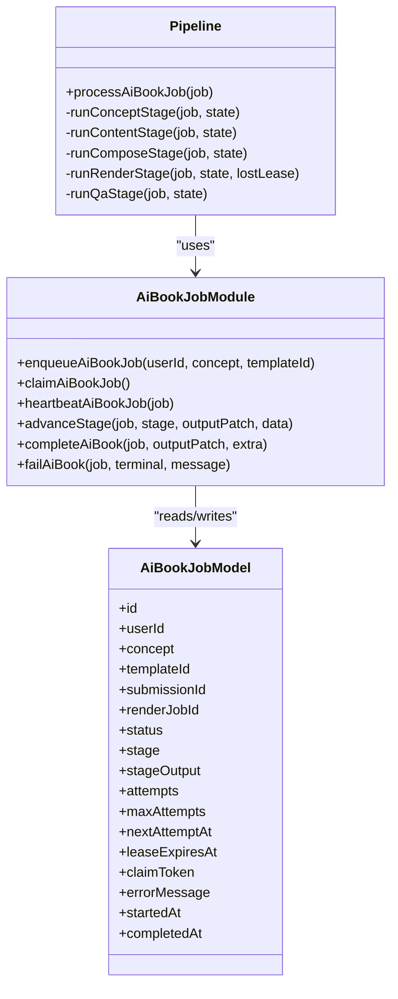
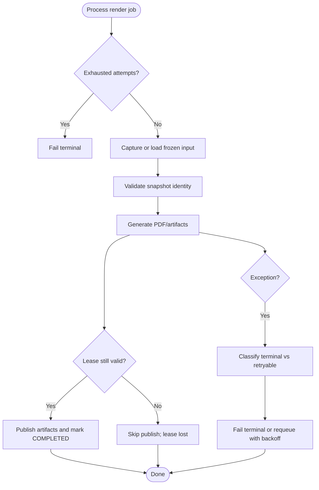
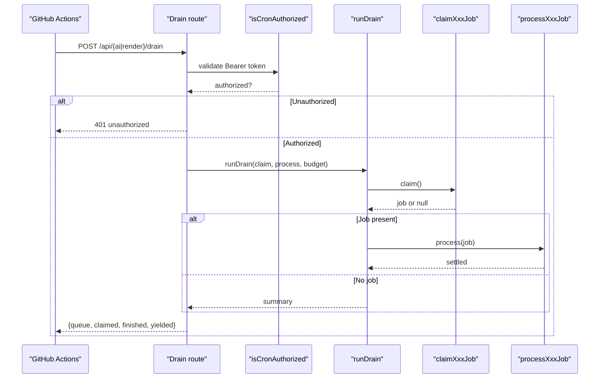
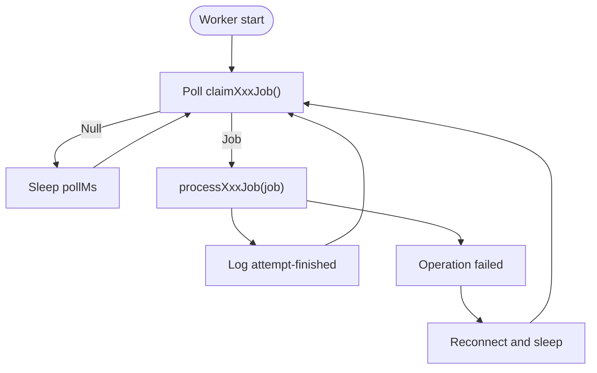
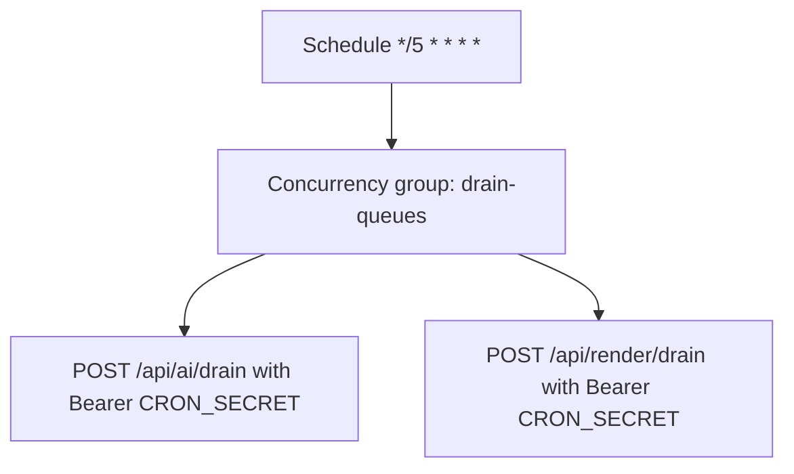
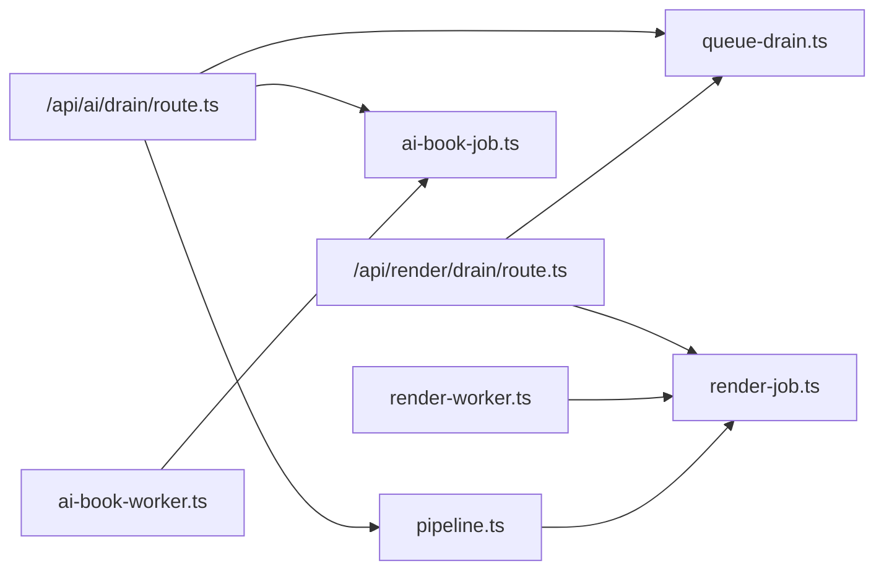

# Serverless Queue Drain System

<cite>
**Referenced Files in This Document**
- [queue-drain.ts](file://src/lib/queue-drain.ts)
- [route.ts (AI drain)](file://src/app\api\ai\drain\route.ts)
- [route.ts (Render drain)](file://src/app\api\render\drain\route.ts)
- [drain.yml](file://.github/workflows/drain.yml)
- [ai-book-worker.ts](file://src/workers/ai-book-worker.ts)
- [render-worker.ts](file://src/workers/render-worker.ts)
- [ai-book-job.ts](file://src/lib/ai/ai-book-job.ts)
- [pipeline.ts](file://src/lib/ai/pipeline.ts)
- [render-job.ts](file://src/lib/pdf/render-job.ts)
- [schema.prisma](file://prisma/schema.prisma)
- [queue-drain.test.ts](file://tests/unit/queue-drain.test.ts)
</cite>

## Table of Contents
1. [Introduction](#introduction)
2. [Project Structure](#project-structure)
3. [Core Components](#core-components)
4. [Architecture Overview](#architecture-overview)
5. [Detailed Component Analysis](#detailed-component-analysis)
6. [Dependency Analysis](#dependency-analysis)
7. [Performance Considerations](#performance-considerations)
8. [Troubleshooting Guide](#troubleshooting-guide)
9. [Conclusion](#conclusion)

## Introduction
This document explains the Serverless Queue Drain System used by the application to process background jobs on serverless platforms such as Vercel. Because long-lived worker processes cannot be hosted there, the system exposes short-lived HTTP endpoints that claim and process due jobs within a strict wall-clock budget. A GitHub Actions workflow triggers these endpoints every five minutes. If a job is still running when the budget expires, its lease expires and a later invocation resumes it from the last persisted stage.

The system supports two queues:
- AI book pipeline queue
- Render queue

Both queues use database-backed leases, heartbeat-based renewal, retry backoff, and terminal failure handling.

## Project Structure
The queue drain system spans API routes, shared draining logic, queue-specific claim/process implementations, workers for non-serverless environments, scheduled CI triggers, and Prisma models.

**Diagram sources**
- [drain.yml:1-44](file://.github/workflows/drain.yml#L1-L44)
- [route.ts (AI drain):1-28](file://src/app\api\ai\drain\route.ts#L1-L28)
- [route.ts (Render drain):1-27](file://src/app\api\render\drain\route.ts#L1-L27)
- [queue-drain.ts:1-91](file://src/lib/queue-drain.ts#L1-L91)
- [ai-book-job.ts:1-186](file://src/lib/ai/ai-book-job.ts#L1-L186)
- [pipeline.ts:1-371](file://src/lib/ai/pipeline.ts#L1-L371)
- [render-job.ts:1-125](file://src/lib/pdf/render-job.ts#L1-L125)
- [ai-book-worker.ts:1-34](file://src/workers/ai-book-worker.ts#L1-L34)
- [render-worker.ts:1-33](file://src/workers/render-worker.ts#L1-L33)

**Section sources**
- [drain.yml:1-44](file://.github/workflows/drain.yml#L1-L44)
- [route.ts (AI drain):1-28](file://src/app\api\ai\drain\route.ts#L1-L28)
- [route.ts (Render drain):1-27](file://src/app\api\render\drain\route.ts#L1-L27)
- [queue-drain.ts:1-91](file://src/lib/queue-drain.ts#L1-L91)

## Core Components
- Shared drain runtime: bounded loop, authorization check, budget enforcement, and summary reporting.
- Serverless drain endpoints: one per queue, guarded by a shared secret.
- Queue claim and process modules: atomic claim with lease, heartbeat, retry/backoff, terminal failures, and completion.
- Workers: long-lived polling loops for environments that support them.
- Scheduler: GitHub Actions workflow invoking drains on schedule.
- Data model: Prisma models for AI book jobs and render jobs with status, attempts, lease, and output snapshots.

Key responsibilities:
- `queue-drain.ts`: Budgeted execution loop and cron authorization helper.
- `/api/ai/drain` and `/api/render/drain`: Route handlers that enforce auth and delegate to `runDrain`.
- `ai-book-job.ts` and `pipeline.ts`: AI book lifecycle, stages, retries, and state persistence.
- `render-job.ts`: PDF rendering lifecycle, snapshot capture, and artifact publishing.
- Workers: Continuous poll-and-process loops mirroring drain behavior.
- `drain.yml`: Scheduled invocations using repository secrets.

**Section sources**
- [queue-drain.ts:1-91](file://src/lib/queue-drain.ts#L1-L91)
- [route.ts (AI drain):1-28](file://src/app\api\ai\drain\route.ts#L1-L28)
- [route.ts (Render drain):1-27](file://src/app\api\render\drain\route.ts#L1-L27)
- [ai-book-job.ts:1-186](file://src/lib/ai/ai-book-job.ts#L1-L186)
- [pipeline.ts:1-371](file://src/lib/ai/pipeline.ts#L1-L371)
- [render-job.ts:1-125](file://src/lib/pdf/render-job.ts#L1-L125)
- [ai-book-worker.ts:1-34](file://src/workers/ai-book-worker.ts#L1-L34)
- [render-worker.ts:1-33](file://src/workers/render-worker.ts#L1-L33)
- [drain.yml:1-44](file://.github/workflows/drain.yml#L1-L44)

## Architecture Overview
The system uses a dual-mode processing model:
- Serverless mode: Short-lived functions invoked by GitHub Actions. They claim due jobs and process them until the function budget expires.
- Long-lived worker mode: Node processes that continuously poll and process jobs.

Lease-based recovery ensures safe interruption:
- Claiming sets a lease expiration time and a unique token.
- Heartbeats extend the lease while work continues.
- If the lease expires, another runner can reclaim the job.
- Processors persist stage outputs so resumed runs continue from the last completed stage.

**Diagram sources**
- [drain.yml:27-43](file://.github/workflows/drain.yml#L27-L43)
- [route.ts (AI drain):12-27](file://src/app\api\ai\drain\route.ts#L12-L27)
- [route.ts (Render drain):12-26](file://src/app\api\render\drain\route.ts#L12-L26)
- [queue-drain.ts:38-90](file://src/lib/queue-drain.ts#L38-L90)
- [ai-book-job.ts:66-81](file://src/lib/ai/ai-book-job.ts#L66-L81)
- [pipeline.ts:317-370](file://src/lib/ai/pipeline.ts#L317-L370)
- [render-job.ts:36-52](file://src/lib/pdf/render-job.ts#L36-L52)
- [render-job.ts:107-124](file://src/lib/pdf/render-job.ts#L107-L124)

## Detailed Component Analysis

### Shared Drain Runtime
The shared runtime provides:
- Cron authorization via a required `CRON_SECRET` bearer token.
- A configurable wall-clock budget per invocation.
- A bounded loop that claims jobs and processes them until either no work remains or the budget is exhausted.
- Safe yielding when remaining time is too small to perform meaningful work.
- Summary metrics: claimed, finished, yielded.

**Diagram sources**
- [queue-drain.ts:26-31](file://src/lib/queue-drain.ts#L26-L31)
- [queue-drain.ts:38-90](file://src/lib/queue-drain.ts#L38-L90)

**Section sources**
- [queue-drain.ts:1-91](file://src/lib/queue-drain.ts#L1-L91)
- [queue-drain.test.ts:10-57](file://tests/unit/queue-drain.test.ts#L10-L57)
- [queue-drain.test.ts:59-98](file://tests/unit/queue-drain.test.ts#L59-L98)

### AI Book Queue
Responsibilities:
- Enqueue with active job limits and configuration checks.
- Atomic claim with lease and attempt tracking.
- Stage-based pipeline: CONCEPT, CONTENT, COMPOSE, RENDER, QA.
- Persistent stage outputs enabling resume after interruption.
- Retry backoff and terminal failure classification.
- Heartbeat-based lease renewal.

**Diagram sources**
- [schema.prisma:223-250](file://prisma/schema.prisma#L223-L250)
- [ai-book-job.ts:42-60](file://src/lib/ai/ai-book-job.ts#L42-L60)
- [ai-book-job.ts:66-91](file://src/lib/ai/ai-book-job.ts#L66-L91)
- [ai-book-job.ts:105-185](file://src/lib/ai/ai-book-job.ts#L105-L185)
- [pipeline.ts:50-56](file://src/lib/ai/pipeline.ts#L50-L56)
- [pipeline.ts:179-301](file://src/lib/ai/pipeline.ts#L179-L301)
- [pipeline.ts:317-370](file://src/lib/ai/pipeline.ts#L317-L370)

**Section sources**
- [ai-book-job.ts:1-186](file://src/lib/ai/ai-book-job.ts#L1-L186)
- [pipeline.ts:1-371](file://src/lib/ai/pipeline.ts#L1-L371)
- [schema.prisma:223-250](file://prisma/schema.prisma#L223-L250)

### Render Queue
Responsibilities:
- Enqueue under submission locks with optional retry and force options.
- Atomic claim with lease and attempt tracking.
- Snapshot-based input capture for deterministic renders.
- Heartbeat-based lease renewal during rendering.
- Publishing artifacts and updating submission/page states.
- Terminal vs retryable failure classification.

**Diagram sources**
- [render-job.ts:107-124](file://src/lib/pdf/render-job.ts#L107-L124)
- [render-job.ts:68-94](file://src/lib/pdf/render-job.ts#L68-L94)
- [render-job.ts:95-106](file://src/lib/pdf/render-job.ts#L95-L106)

**Section sources**
- [render-job.ts:1-125](file://src/lib/pdf/render-job.ts#L1-L125)
- [schema.prisma:252-274](file://prisma/schema.prisma#L252-L274)

### Serverless Drain Endpoints
Each endpoint:
- Requires a matching `CRON_SECRET` bearer token.
- Delegates to `runDrain` with the appropriate claim and process functions.
- Returns a JSON summary including queue name and counts.

**Diagram sources**
- [route.ts (AI drain):12-27](file://src/app\api\ai\drain\route.ts#L12-L27)
- [route.ts (Render drain):12-26](file://src/app\api\render\drain\route.ts#L12-L26)
- [queue-drain.ts:26-31](file://src/lib/queue-drain.ts#L26-L31)
- [queue-drain.ts:38-90](file://src/lib/queue-drain.ts#L38-L90)

**Section sources**
- [route.ts (AI drain):1-28](file://src/app\api\ai\drain\route.ts#L1-L28)
- [route.ts (Render drain):1-27](file://src/app\api\render\drain\route.ts#L1-L27)
- [queue-drain.ts:26-31](file://src/lib/queue-drain.ts#L26-L31)

### Workers (Long-Lived Mode)
Workers provide continuous polling for environments that can host long-running processes. They mirror the drain behavior:
- Poll for due jobs.
- Claim and process.
- Log events and reconnect on errors.
- Graceful shutdown with lease expiry reclaim.

**Diagram sources**
- [ai-book-worker.ts:17-33](file://src/workers/ai-book-worker.ts#L17-L33)
- [render-worker.ts:17-32](file://src/workers/render-worker.ts#L17-L32)

**Section sources**
- [ai-book-worker.ts:1-34](file://src/workers/ai-book-worker.ts#L1-L34)
- [render-worker.ts:1-33](file://src/workers/render-worker.ts#L1-L33)

### Scheduler
The GitHub Actions workflow:
- Runs every five minutes.
- Calls both drain endpoints with the configured production URL and shared secret.
- Uses concurrency control to avoid overlapping runs.

**Diagram sources**
- [drain.yml:12-20](file://.github/workflows/drain.yml#L12-L20)
- [drain.yml:27-43](file://.github/workflows/drain.yml#L27-L43)

**Section sources**
- [drain.yml:1-44](file://.github/workflows/drain.yml#L1-L44)

## Dependency Analysis
The following diagram shows module-level dependencies between the drain runtime, endpoints, queue modules, and workers.

**Diagram sources**
- [queue-drain.ts:1-91](file://src/lib/queue-drain.ts#L1-L91)
- [route.ts (AI drain):1-28](file://src/app\api\ai\drain\route.ts#L1-L28)
- [route.ts (Render drain):1-27](file://src/app\api\render\drain\route.ts#L1-L27)
- [ai-book-job.ts:1-186](file://src/lib/ai/ai-book-job.ts#L1-L186)
- [pipeline.ts:1-371](file://src/lib/ai/pipeline.ts#L1-L371)
- [render-job.ts:1-125](file://src/lib/pdf/render-job.ts#L1-L125)
- [ai-book-worker.ts:1-34](file://src/workers/ai-book-worker.ts#L1-L34)
- [render-worker.ts:1-33](file://src/workers/render-worker.ts#L1-L33)

**Section sources**
- [queue-drain.ts:1-91](file://src/lib/queue-drain.ts#L1-L91)
- [route.ts (AI drain):1-28](file://src/app\api\ai\drain\route.ts#L1-L28)
- [route.ts (Render drain):1-27](file://src/app\api\render\drain\route.ts#L1-L27)
- [ai-book-job.ts:1-186](file://src/lib/ai/ai-book-job.ts#L1-L186)
- [pipeline.ts:1-371](file://src/lib/ai/pipeline.ts#L1-L371)
- [render-job.ts:1-125](file://src/lib/pdf/render-job.ts#L1-L125)
- [ai-book-worker.ts:1-34](file://src/workers/ai-book-worker.ts#L1-L34)
- [render-worker.ts:1-33](file://src/workers/render-worker.ts#L1-L33)

## Performance Considerations
- Wall-clock budget: The drain loop stops when the budget is reached, preventing serverless timeouts. Configure `DRAIN_BUDGET_MS` within allowed bounds.
- Lease durations:
  - Render jobs: shorter lease suitable for I/O-bound rendering.
  - AI book jobs: longer lease for LLM calls.
- Heartbeat intervals:
  - Render: frequent heartbeats to keep short leases alive.
  - AI: less frequent heartbeats aligned with slower stages.
- Retry backoff: Both queues implement exponential-like delays to reduce contention and handle transient failures.
- Concurrency:
  - AI queue enforces a maximum number of active jobs per user.
  - GitHub Actions uses a concurrency group to serialize drain runs.

[No sources needed since this section provides general guidance]

## Troubleshooting Guide
Common issues and resolutions:
- Unauthorized drain requests: Ensure `CRON_SECRET` is set in the serverless environment and matches the value used by the scheduler.
- No jobs processed: Verify that due jobs exist and are not blocked by retry backoff or lease constraints.
- Frequent yields: Reduce workload or increase `DRAIN_BUDGET_MS` within platform limits.
- Lease lost mid-processing: Expected behavior; ensure processors persist stage outputs so resumed runs continue correctly.
- Terminal failures: Some errors should mark jobs FAILED without retries. Review error classification in queue processors.
- Worker shutdown: Workers exit gracefully; unfinished work is reclaimed when leases expire.

Operational checks:
- Confirm GitHub Actions secrets `PROD_URL` and `CRON_SECRET` are configured.
- Monitor drain summaries returned by endpoints for claimed, finished, and yielded counts.
- Inspect job logs for events like stage transitions, lease loss, and failures.

**Section sources**
- [queue-drain.ts:26-31](file://src/lib/queue-drain.ts#L26-L31)
- [queue-drain.ts:38-90](file://src/lib/queue-drain.ts#L38-L90)
- [ai-book-job.ts:164-185](file://src/lib/ai/ai-book-job.ts#L164-L185)
- [render-job.ts:81-94](file://src/lib/pdf/render-job.ts#L81-L94)
- [pipeline.ts:357-370](file://src/lib/ai/pipeline.ts#L357-L370)
- [render-worker.ts:17-32](file://src/workers/render-worker.ts#L17-L32)
- [ai-book-worker.ts:17-33](file://src/workers/ai-book-worker.ts#L17-L33)

## Conclusion
The Serverless Queue Drain System enables reliable background processing on serverless platforms by combining short-lived, budgeted HTTP endpoints with robust database-backed leases, heartbeats, and persistent stage outputs. It supports both serverless-driven drains and long-lived workers, ensuring consistent behavior across deployment targets. Proper configuration of secrets, budgets, and environment variables is essential for stable operation. Monitoring drain summaries and job logs helps maintain healthy throughput and quick recovery from interruptions.

[No sources needed since this section summarizes without analyzing specific files]