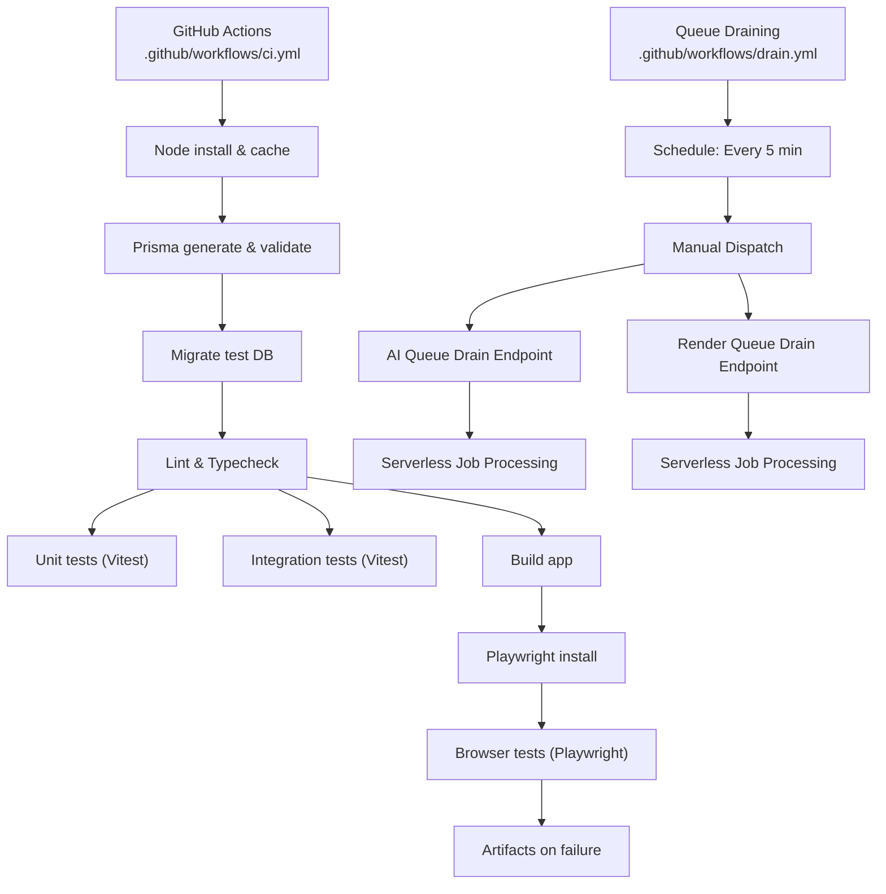
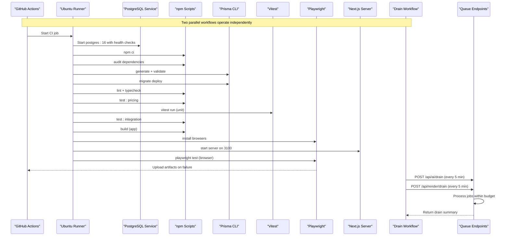
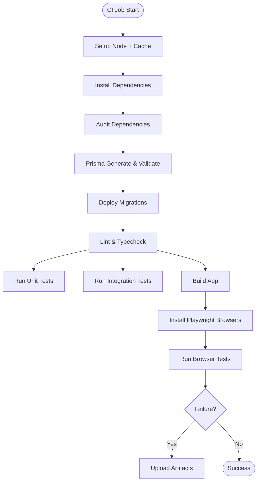
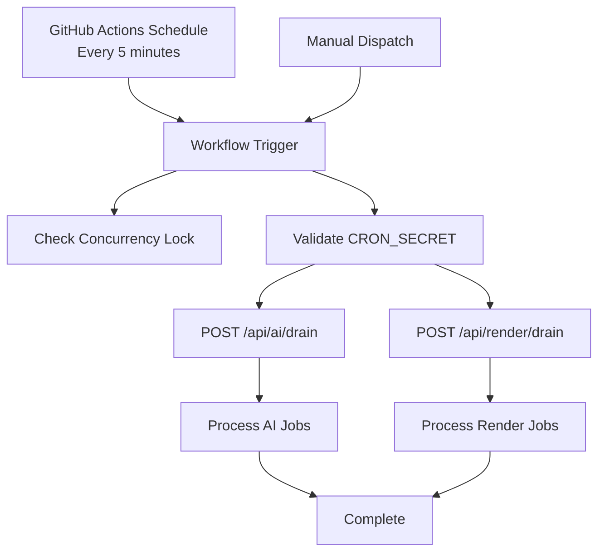
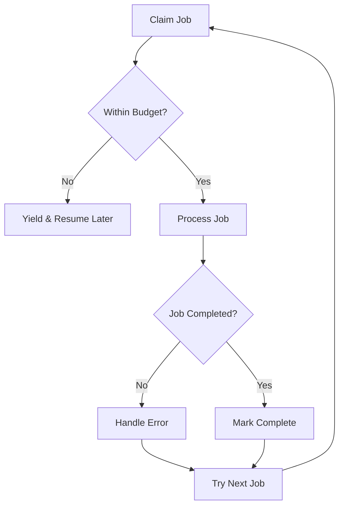
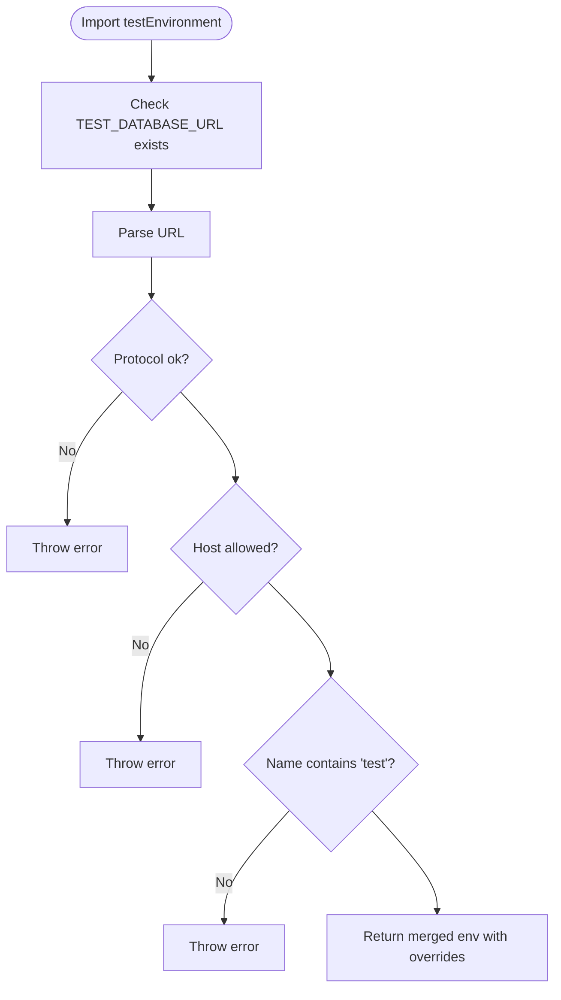
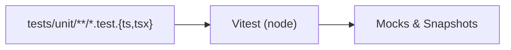
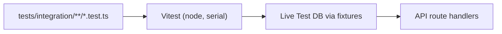
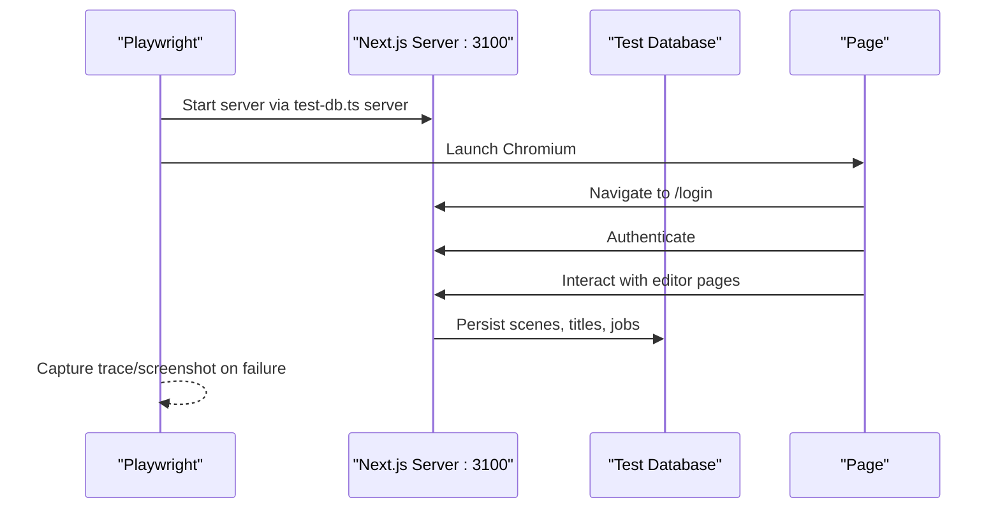
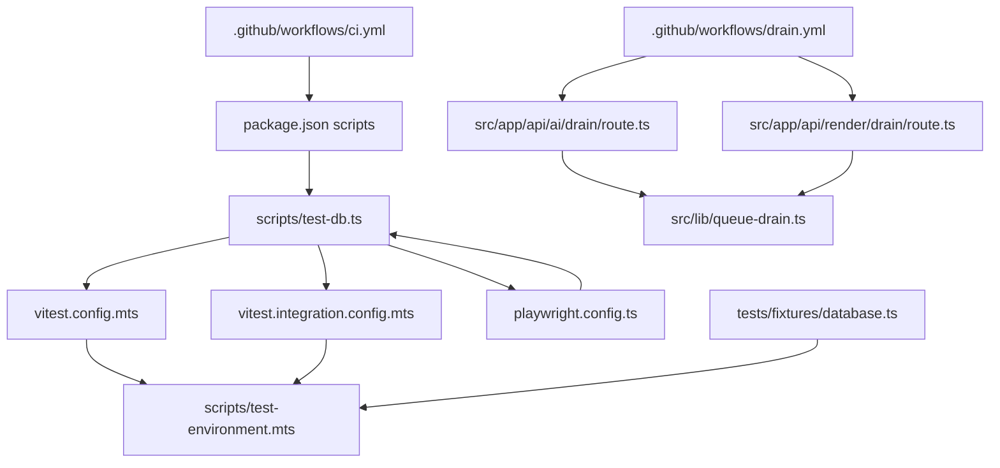

# CI/CD Pipeline & Automated Testing

<cite>
**Referenced Files in This Document**
- [ci.yml](file://.github/workflows/ci.yml)
- [drain.yml](file://.github/workflows/drain.yml)
- [package.json](file://package.json)
- [vitest.config.mts](file://vitest.config.mts)
- [vitest.integration.config.mts](file://vitest.integration.config.mts)
- [playwright.config.ts](file://playwright.config.ts)
- [test-db.ts](file://scripts/test-db.ts)
- [test-environment.mts](file://scripts/test-environment.mts)
- [database.ts](file://tests/fixtures/database.ts)
- [auth.spec.ts](file://tests/browser/auth.spec.ts)
- [editor.spec.ts](file://tests/browser/editor.spec.ts)
- [editor-queue.test.ts](file://tests/integration/editor-queue.test.ts)
- [rendering.test.ts](file://tests/unit/rendering.test.ts)
- [test-environment.test.ts](file://tests/unit/test-environment.test.ts)
- [route.ts](file://src/app/api/ai/drain/route.ts)
- [route.ts](file://src/app/api/render/drain/route.ts)
- [queue-drain.ts](file://src/lib/queue-drain.ts)
- [ai-book-worker.ts](file://src/workers/ai-book-worker.ts)
- [render-worker.ts](file://src/workers/render-worker.ts)
</cite>

## Update Summary
**Changes Made**
- Added new section documenting the automated queue draining workflow (.github/workflows/drain.yml)
- Updated architecture overview to include background job processing infrastructure
- Enhanced dependency analysis to show relationship between drain workflows and API endpoints
- Added troubleshooting guidance for queue draining configuration

## Table of Contents
1. [Introduction](#introduction)
2. [Project Structure](#project-structure)
3. [Core Components](#core-components)
4. [Architecture Overview](#architecture-overview)
5. [Detailed Component Analysis](#detailed-component-analysis)
6. [Dependency Analysis](#dependency-analysis)
7. [Performance Considerations](#performance-considerations)
8. [Troubleshooting Guide](#troubleshooting-guide)
9. [Conclusion](#conclusion)

## Introduction
This document explains the CI/CD pipeline and automated testing strategy for the application. It covers how continuous integration runs reliability checks, how unit, integration, and browser tests are configured and executed, and how a secure test environment isolates databases and external services during CI and local runs. Additionally, it documents the automated background job processing system that handles AI book generation and PDF rendering queues through scheduled GitHub Actions workflows.

## Project Structure
The testing and CI infrastructure is organized around:
- GitHub Actions workflows that orchestrate dependency installation, database setup, migrations, linting, type checking, and all test suites.
- A separate automated queue draining workflow that processes background jobs every 5 minutes with manual dispatch capability.
- A unified test entry script that delegates to Prisma, Vitest, and Playwright with consistent environment variables.
- Separate configurations for unit and integration tests, plus a Playwright configuration that starts a Next.js server on a dedicated port for end-to-end scenarios.
- A strict test environment helper that enforces safe database targets and overrides sensitive provider credentials.
- Background job processing infrastructure supporting both long-lived worker processes and serverless queue draining.



**Diagram sources**
- [ci.yml:1-53](file://.github/workflows/ci.yml#L1-L53)
- [drain.yml:1-44](file://.github/workflows/drain.yml#L1-L44)
- [package.json:5-18](file://package.json#L5-L18)

**Section sources**
- [ci.yml:1-53](file://.github/workflows/ci.yml#L1-L53)
- [drain.yml:1-44](file://.github/workflows/drain.yml#L1-L44)
- [package.json:5-18](file://package.json#L5-L18)

## Core Components
- CI pipeline job: provisions a PostgreSQL service, sets test-only environment variables, runs migrations, lints, typechecks, executes unit and integration tests, builds the app, installs Playwright browsers, and runs browser tests. Artifacts are uploaded on failure.
- **New** Queue draining workflow: automated background job processor running every 5 minutes via GitHub Actions schedule, with manual dispatch capability for immediate processing.
- Test scripts: a single CLI wrapper that invokes Prisma, Vitest, and Playwright with shared environment variables.
- Unit test runner: Vitest configured for Node environment with alias resolution and isolated mocks.
- Integration test runner: Vitest configured for serial execution against a live test database.
- Browser test runner: Playwright configured to start a Next.js server on port 3100, run Chromium tests, capture traces/screenshots on failure, and enforce forbidOnly in CI.
- Test environment helper: validates TEST_DATABASE_URL format and hostname, forces test-only credentials, and ensures application DATABASE_URL is never used by tests.
- **New** Queue processing infrastructure: bounded, resume-based queue drain system for serverless hosts that claims due jobs and processes them within wall-clock budgets, with lease-based recovery for unfinished work.

**Section sources**
- [ci.yml:1-53](file://.github/workflows/ci.yml#L1-L53)
- [drain.yml:1-44](file://.github/workflows/drain.yml#L1-L44)
- [test-db.ts:1-27](file://scripts/test-db.ts#L1-L27)
- [vitest.config.mts:1-13](file://vitest.config.mts#L1-L13)
- [vitest.integration.config.mts:1-19](file://vitest.integration.config.mts#L1-L19)
- [playwright.config.ts:1-25](file://playwright.config.ts#L1-L25)
- [test-environment.mts:1-28](file://scripts/test-environment.mts#L1-L28)
- [queue-drain.ts:1-91](file://src/lib/queue-drain.ts#L1-L91)

## Architecture Overview
The CI pipeline coordinates multiple stages to ensure code quality and correctness before merging or deploying. The queue draining system provides background job processing capabilities for serverless environments where long-lived worker processes cannot be maintained. The flow below maps directly to the workflow steps and scripts.



**Diagram sources**
- [ci.yml:1-53](file://.github/workflows/ci.yml#L1-L53)
- [drain.yml:1-44](file://.github/workflows/drain.yml#L1-L44)
- [test-db.ts:1-27](file://scripts/test-db.ts#L1-L27)
- [playwright.config.ts:16-23](file://playwright.config.ts#L16-L23)

## Detailed Component Analysis

### CI Workflow Reliability Checks
- Triggers on pull requests and pushes.
- Uses an Ubuntu runner with a 20-minute timeout.
- Spins up a PostgreSQL service with explicit credentials and health checks.
- Sets TEST_DATABASE_URL and DATABASE_URL to point at the service container.
- Executes dependency audit, Prisma generation/validation, migration deployment, linting, typechecking, pricing tests, unit tests, integration tests, app build, Playwright browser install, and browser tests.
- Uploads Playwright reports and test results on failure for 7 days.



**Diagram sources**
- [ci.yml:1-53](file://.github/workflows/ci.yml#L1-L53)

**Section sources**
- [ci.yml:1-53](file://.github/workflows/ci.yml#L1-L53)

### Automated Queue Draining Workflow
**New** The queue draining workflow provides automated background job processing for serverless environments where long-lived worker processes cannot be maintained.

- **Schedule**: Runs every 5 minutes using GitHub Actions cron syntax (`*/5 * * * *`).
- **Manual Dispatch**: Supports manual triggering via GitHub Actions UI for immediate processing.
- **Concurrency Control**: Uses `cancel-in-progress: false` to prevent overlapping drain operations.
- **Security**: Requires `PROD_URL` and `CRON_SECRET` repository secrets for authenticated access.
- **Timeout**: Limited to 5 minutes per run to prevent resource exhaustion.
- **Endpoints**: Calls `/api/ai/drain` and `/api/render/drain` with Bearer token authentication.



**Diagram sources**
- [drain.yml:1-44](file://.github/workflows/drain.yml#L1-L44)
- [route.ts:1-28](file://src/app/api/ai/drain/route.ts#L1-L28)
- [route.ts:1-27](file://src/app/api/render/drain/route.ts#L1-L27)

**Section sources**
- [drain.yml:1-44](file://.github/workflows/drain.yml#L1-L44)
- [route.ts:1-28](file://src/app/api/ai/drain/route.ts#L1-L28)
- [route.ts:1-27](file://src/app/api/render/drain/route.ts#L1-L27)

### Queue Processing Infrastructure
**New** The queue processing system provides bounded, resume-based job processing designed for serverless environments.

- **Budget Management**: Each drain invocation operates within a configurable wall-clock budget (default 45 seconds).
- **Lease-Based Recovery**: Unfinished jobs are abandoned when budget expires; leases expire allowing later invocations to resume from persisted stages.
- **Security Model**: Requires `CRON_SECRET` environment variable and Bearer token authentication for all drain endpoints.
- **Error Handling**: Transient database errors stop processing; job processors handle their own errors and mark jobs as FAILED.
- **Worker Alternative**: Long-lived worker processes (`worker:ai`, `worker:render`) provide alternative processing for non-serverless environments.



**Diagram sources**
- [queue-drain.ts:38-90](file://src/lib/queue-drain.ts#L38-L90)

**Section sources**
- [queue-drain.ts:1-91](file://src/lib/queue-drain.ts#L1-L91)
- [ai-book-worker.ts:1-34](file://src/workers/ai-book-worker.ts#L1-L34)
- [render-worker.ts:1-33](file://src/workers/render-worker.ts#L1-L33)

### Test Environment Safety and Overrides
- Enforces that TEST_DATABASE_URL is set explicitly; application DATABASE_URL is never used for tests.
- Validates protocol, hostname, and database name patterns to prevent accidental writes to non-test databases.
- Overrides sensitive environment variables with test-only values (e.g., AWS, OpenAI, Resend).
- Ensures NextAuth URLs and trust settings are suitable for localhost testing.



**Diagram sources**
- [test-environment.mts:1-28](file://scripts/test-environment.mts#L1-L28)

**Section sources**
- [test-environment.mts:1-28](file://scripts/test-environment.mts#L1-L28)
- [test-environment.test.ts:1-26](file://tests/unit/test-environment.test.ts#L1-L26)

### Unified Test Script Orchestration
- Provides commands for migrating the test database, running integration tests, launching browser tests, building the app, and starting the server on port 3100.
- Delegates to Prisma, Vitest, and Playwright while inheriting the validated environment from the test environment helper.

```mermaid
flowchart TD
Arg["CLI arg"] --> Migrate{"migrate?"}
Arg --> Integration{"integration?"}
Arg --> Browser{"browser?"}
Arg --> Build{"build?"}
Arg --> Server{"server?"}
Migrate --> |Yes| PrismaMigrate["Prisma migrate deploy + diff"]
Integration --> |Yes| VitestInt["Vitest integration config"]
Browser --> |Yes| Playwright["Playwright test"]
Build --> |Yes| PrismaGen["Prisma generate"] + NextBuild["Next build"]
Server --> |Yes| NextStart["Next start -p 3100"]
```

**Diagram sources**
- [test-db.ts:1-27](file://scripts/test-db.ts#L1-L27)

**Section sources**
- [test-db.ts:1-27](file://scripts/test-db.ts#L1-L27)

### Unit Tests (Vitest)
- Target directory: tests/unit.
- Node environment with aliases and mock cleanup enabled.
- Example coverage includes rendering logic, PDF generation, and snapshot parsing.



**Diagram sources**
- [vitest.config.mts:1-13](file://vitest.config.mts#L1-L13)
- [rendering.test.ts:1-66](file://tests/unit/rendering.test.ts#L1-L66)

**Section sources**
- [vitest.config.mts:1-13](file://vitest.config.mts#L1-L13)
- [rendering.test.ts:1-66](file://tests/unit/rendering.test.ts#L1-L66)

### Integration Tests (Vitest)
- Target directory: tests/integration.
- Serial execution with longer timeouts to coordinate with a live test database.
- Exercises editor APIs, transactional submissions, render queue behavior, worker claims, retries, and admin moderation flows.



**Diagram sources**
- [vitest.integration.config.mts:1-19](file://vitest.integration.config.mts#L1-L19)
- [editor-queue.test.ts:1-306](file://tests/integration/editor-queue.test.ts#L1-L306)
- [database.ts:1-36](file://tests/fixtures/database.ts#L1-L36)

**Section sources**
- [vitest.integration.config.mts:1-19](file://vitest.integration.config.mts#L1-L19)
- [editor-queue.test.ts:1-306](file://tests/integration/editor-queue.test.ts#L1-L306)
- [database.ts:1-36](file://tests/fixtures/database.ts#L1-L36)

### Browser Tests (Playwright)
- Targets: tests/browser.
- Starts a Next.js server on port 3100 using the same test environment.
- Runs Chromium with a fixed viewport, captures traces/screenshots on failure, and enforces forbidOnly in CI.
- Tests cover authentication guards, public vs protected routes, session handling, editor workflows, save failures, AI assistant interactions, and recovery after reload.



**Diagram sources**
- [playwright.config.ts:1-25](file://playwright.config.ts#L1-L25)
- [auth.spec.ts:1-85](file://tests/browser/auth.spec.ts#L1-L85)
- [editor.spec.ts:1-152](file://tests/browser/editor.spec.ts#L1-L152)

**Section sources**
- [playwright.config.ts:1-25](file://playwright.config.ts#L1-L25)
- [auth.spec.ts:1-85](file://tests/browser/auth.spec.ts#L1-L85)
- [editor.spec.ts:1-152](file://tests/browser/editor.spec.ts#L1-L152)

## Dependency Analysis
The following diagram shows how CI, scripts, and test runners depend on each other and on the test environment, including the new queue draining infrastructure.



**Diagram sources**
- [ci.yml:1-53](file://.github/workflows/ci.yml#L1-L53)
- [drain.yml:1-44](file://.github/workflows/drain.yml#L1-L44)
- [package.json:5-18](file://package.json#L5-L18)
- [test-db.ts:1-27](file://scripts/test-db.ts#L1-L27)
- [test-environment.mts:1-28](file://scripts/test-environment.mts#L1-L28)
- [vitest.config.mts:1-13](file://vitest.config.mts#L1-L13)
- [vitest.integration.config.mts:1-19](file://vitest.integration.config.mts#L1-L19)
- [playwright.config.ts:1-25](file://playwright.config.ts#L1-L25)
- [database.ts:1-36](file://tests/fixtures/database.ts#L1-L36)
- [route.ts:1-28](file://src/app/api/ai/drain/route.ts#L1-L28)
- [route.ts:1-27](file://src/app/api/render/drain/route.ts#L1-L27)
- [queue-drain.ts:1-91](file://src/lib/queue-drain.ts#L1-L91)

**Section sources**
- [ci.yml:1-53](file://.github/workflows/ci.yml#L1-L53)
- [drain.yml:1-44](file://.github/workflows/drain.yml#L1-L44)
- [package.json:5-18](file://package.json#L5-L18)
- [test-db.ts:1-27](file://scripts/test-db.ts#L1-L27)
- [test-environment.mts:1-28](file://scripts/test-environment.mts#L1-L28)
- [vitest.config.mts:1-13](file://vitest.config.mts#L1-L13)
- [vitest.integration.config.mts:1-19](file://vitest.integration.config.mts#L1-L19)
- [playwright.config.ts:1-25](file://playwright.config.ts#L1-L25)
- [database.ts:1-36](file://tests/fixtures/database.ts#L1-L36)
- [route.ts:1-28](file://src/app/api/ai/drain/route.ts#L1-L28)
- [route.ts:1-27](file://src/app/api/render/drain/route.ts#L1-L27)
- [queue-drain.ts:1-91](file://src/lib/queue-drain.ts#L1-L91)

## Performance Considerations
- Use a dedicated PostgreSQL service in CI to avoid flaky network calls and ensure isolation.
- Keep integration tests serial to reduce contention on the test database and simplify assertions about state transitions.
- Limit Playwright workers to one per run to stabilize UI tests and reduce resource pressure in CI.
- Enable artifact uploads only on failure to minimize storage usage while preserving diagnostics when needed.
- Reuse cached node_modules via npm caching to speed up subsequent runs.
- **New** Queue draining uses bounded budgets (45 seconds default) to prevent function timeout issues in serverless environments.
- **New** Lease-based job recovery allows background processing to resume from persisted stages after interruption.
- **New** Concurrency control prevents overlapping drain operations that could cause race conditions.

[No sources needed since this section provides general guidance]

## Troubleshooting Guide
- Missing TEST_DATABASE_URL: The test environment helper will throw an error if not set. Ensure it points to a local PostgreSQL instance with a database name containing "test".
- Unsafe database target: If the host is remote or the database name does not match the expected pattern, the helper rejects it to protect production data.
- External provider calls blocked: Integration and browser tests stub or block external HTTP to prevent secrets leakage and flakiness. If tests fail due to missing mocks, add appropriate stubs.
- Playwright failures: Inspect uploaded artifacts (reports and screenshots) and traces retained on failure. Verify the Next.js server started successfully on port 3100 and that the test database was migrated.
- Migration issues: Confirm that migrations have been deployed before running integration or browser tests. Use the migrate command through the test script to apply schema changes.
- **New** Queue draining not processing jobs: Verify that `PROD_URL` and `CRON_SECRET` repository secrets are configured in GitHub Actions. Check that the drain endpoints return successful HTTP status codes and that the CRON_SECRET matches the application's `CRON_SECRET` environment variable.
- **New** Queue draining timeout issues: Adjust the `DRAIN_BUDGET_MS` environment variable if jobs require more processing time. Ensure the budget stays within the function's `maxDuration` limit (60 seconds for drain endpoints).
- **New** Unauthorized drain requests: Ensure the `authorization: Bearer $CRON_SECRET` header is correctly formatted and that the CRON_SECRET value matches between GitHub Actions secrets and application environment variables.

**Section sources**
- [test-environment.mts:1-28](file://scripts/test-environment.mts#L1-L28)
- [test-environment.test.ts:1-26](file://tests/unit/test-environment.test.ts#L1-L26)
- [ci.yml:45-53](file://.github/workflows/ci.yml#L45-L53)
- [playwright.config.ts:16-23](file://playwright.config.ts#L16-L23)
- [test-db.ts:11-24](file://scripts/test-db.ts#L11-L24)
- [drain.yml:8-10](file://.github/workflows/drain.yml#L8-L10)
- [queue-drain.ts:26-31](file://src/lib/queue-drain.ts#L26-L31)
- [route.ts:13-16](file://src/app/api/ai/drain/route.ts#L13-L16)
- [route.ts:12-15](file://src/app/api/render/drain/route.ts#L12-L15)

## Conclusion
The CI/CD pipeline integrates robust safety checks, comprehensive test coverage across unit, integration, and browser layers, and a hardened test environment to prevent accidental access to production resources. The addition of automated queue draining provides reliable background job processing for serverless environments, ensuring that AI book generation and PDF rendering tasks complete even without long-lived worker processes. By enforcing strict database targeting, serializing integration tests, capturing detailed artifacts on failure, and implementing bounded queue processing with lease-based recovery, the system maintains high reliability and fast feedback for contributors while supporting complex background workloads.

[No sources needed since this section summarizes without analyzing specific files]