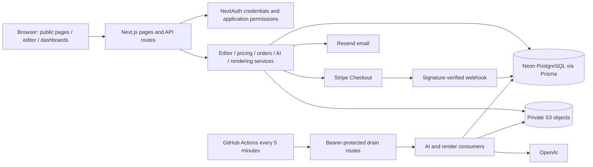

# Current Architecture — Phase 0

Audit date: November 17, 2026. Status: read-only audit complete; implementation
not authorized.

## Scope and evidence

The complete 1,458-line [master brief](../../next-phase-dev.md) was read. Its
encoding produces some replacement characters in the file reader; the file was
not repaired or changed. This report covers the existing application, not an
assumed historical WordPress, SQLite, or Supabase implementation.

Repository baseline: the inspected code state was branch `baseline-capture`,
commit `416d2c1fc09221d5254ab5a2afbd2ef5d782e982`. At inspection time these
documents were untracked audit outputs; they were first committed in `718f1e9`
("Land payment reconciliation, immutable quotes, asset safety and PDF
downloads"), which also landed post-audit hardening. `718f1e9` is therefore the
package's landing commit, not the inspected baseline. Existing untracked
`next-phase-dev.md` and `dashboard-monitor.png` were preserved. Only the eight
requested documents in this directory are audit outputs. The audit itself
changed no source, schema, migration, dependency, environment, or production
setting.

Evidence labels used throughout the audit:

- **Source:** current repository behavior, including one scoped independent
  read-only review of correctness, security, and financial boundaries.
- **Database:** catalog/configuration queries and non-personal aggregates
  against the configured remote database, in explicit `READ ONLY` transactions.
- **Live:** bounded HTTP GETs against `https://app.titchybooks.com` and AWS
  read-only bucket configuration calls.
- **External status:** read-only GitHub commit/workflow status, distinguished
  from tests executed by this audit.
- **Proposed:** a future design requiring approval; not implemented.
- **Unverified:** not established by this audit. Existing tests are evidence of
  intended coverage, not a fresh passing result.

Inspection covered all application subsystems and route families, schema
objects, operational configuration, migrations, and test infrastructure. Large
editor/AI/UI files were assessed through relevant implementation boundaries and
supporting tests; this is not a claim that every UI branch was executed or every
line independently proven correct. No mutating live journeys, builds, tests,
installations, seeds, worker runs, or workflow dispatches were performed. Exact
deployed commit and production environment variables were not independently
attested.

## Post-audit revision — November 19, 2026

Commit `718f1e9` changed the application after the November 17 inspection.
Verified deltas against current source; inventories in this document are
updated accordingly, and superseded observations are labeled as baseline:

- Four migrations were added (`20261117190000_asset_soft_removal`,
  `20261118120000_atomic_order_settlement`,
  `20261119120000_immutable_order_quotes`,
  `20261120120000_payment_reconciliation`): 19 repository migrations.
- Two models were added (`PaymentAttempt`, `PaymentEvent`): 16 application
  models. `Asset` gained `deletedAt`; `Order` gained immutable-quote,
  request-idempotency, settlement-evidence and payment-projection columns;
  `VaultEntry.orderId` is now unique.
- Two routes were added (`submissions/[id]/downloads`,
  `admin/orders/[id]/payment`): 50 `route.ts` files.
- Payment retry validates the pinned accepted quote and frozen configuration
  instead of re-pricing at current FX; settlement uses `FOR UPDATE` row locking
  plus compare-and-set; signed webhook deliveries are durably recorded with
  unique provider event IDs and reconciled against expected amounts.
- Asset deletion is reference-guarded soft removal; both template deletion
  routes enforce the same dependent guard; private asset/PDF responses use
  `private, no-store` headers; PDF downloads stream same-origin instead of
  issuing signed GET URLs.
- The session callback re-reads the current role from the database; reset
  tokens are redeemed by one atomic conditional update; asset registration
  verifies staged bytes server-side before storing canonical references.

## Executive assessment

The application is a substantial, reusable Next.js modular monolith:
authenticated booklet creation, a rich editor, reusable templates, autonomous AI
generation, durable rendering, approval, owner print ordering, configurable HUF
pricing, Stripe Checkout, and an opt-in physical vault directory already exist.

It is not yet a public publishing marketplace. There are no public commercial
listings, multi-book order items, purchased-PDF entitlements, royalty/payout
accounting, sponsor campaigns, independent sponsored editions, distribution
stock records, or QR engagement subsystem.

Preserve the existing stack and content/order identities. Expand around its
existing service boundaries. Do not replace the editor, render pipeline, pricing
primitives, authentication provider, database, or payment provider to deliver
the brief.

## Runtime and dependencies

Versions below are declarations in `package.json`, not proof of the exact
package deployed on Vercel.

| Layer               | Existing technology                                                           |
| ------------------- | ----------------------------------------------------------------------------- |
| UI and web server   | Next.js `^16.4.5`, React/React DOM `19.2.3`, App Router                       |
| Language/style      | TypeScript, Tailwind CSS 4, ESLint 9                                          |
| Authentication      | NextAuth `^5.0.0-beta.32`, Credentials provider, JWT sessions, bcryptjs       |
| Persistence         | Prisma/client `^5.22.0`, PostgreSQL; queried client 5.22.0                    |
| Configured database | Neon PostgreSQL 17.12, database `neondb`                                      |
| Editor              | Konva `^10.2.5`, react-konva `^19.2.3`, serialized scenes                     |
| Rendering           | pdf-lib `^1.17.1`, sharp `^0.35.4`, opentype.js `2.0.0`, bundled design fonts |
| Validation          | Zod `^4.6.7`                                                                  |
| Object storage      | AWS S3 SDK; presigned uploads/downloads                                       |
| Payments            | Stripe `^23.0.0`, hosted Checkout and signed webhook                          |
| Email               | Resend `^6.12.4`                                                              |
| AI                  | OpenAI `^6.39.1`, streaming editor assistance and queued generation           |
| Tests               | Vitest `^4.1.11`, Playwright `^1.63.0`                                        |
| Runtime tooling     | Local Node 22.16.0 observed; CI Node 22; concurrently `^10.0.7`               |

## Component topology

Server route handlers are the API boundary; shared `src/lib` modules carry
domain behavior. Some orchestration remains in route handlers. There is no
separate REST backend deployment or browser-to-database client in the inspected
application.

### Source map and reuse boundaries

| Area                          | Main source                                                                       | Existing responsibility / reuse                                                                                               |
| ----------------------------- | --------------------------------------------------------------------------------- | ----------------------------------------------------------------------------------------------------------------------------- |
| App shell/public presentation | `src/app/{layout,page,globals.css}`, `src/components/{home,layout,ui}`            | Branding, navigation, marketing, loading/error components; marketing claims are not implemented commercial features           |
| Identity                      | `src/auth.ts`, `src/proxy.ts`, `src/app/(auth)`, `src/components/auth`            | Credentials, JWT session, protected navigation, same-origin mutation checks, reset flow                                       |
| Creation/dashboard            | `src/app/(protected)`, `src/components/{create,dashboard,submissions}`            | Drafts, AI status, templates, owner books, orders and vault consent                                                           |
| Editor                        | `src/components/editor`, `src/lib/editor`, `src/types`                            | Canvas, filmstrip, booklet preview, guided design, fonts, history, asset placement, serialized scenes, revisioned persistence |
| AI                            | `src/lib/ai`, `src/workers/ai-book-worker.ts`                                     | Prompt/contracts, template preflight, content flow, composition, QA, leases and idempotency                                   |
| PDF                           | `src/lib/pdf`, `src/workers/render-worker.ts`                                     | Frozen input, vector/raster rendering, print/reading artifacts, checksums and job fencing                                     |
| Print commerce                | `src/lib/pricing`, `src/components/orders`, `src/lib/stripe.ts`, `src/lib/orders` | Quantity tiers, weight/zone shipping, currency, Checkout, status transitions and reconciliation alerts                        |
| Administration                | `src/app/(admin)`, `src/components/admin`                                         | Submissions, templates, pricing, orders, payment alerts and queue monitor                                                     |
| Infrastructure                | `src/lib/{prisma,s3,email,rate-limit,queue-drain,queue-health,env-validation}.ts` | Clients, durable throttling, observability, config validation                                                                 |
| Operations/test setup         | `.github/workflows`, `scripts`, `tests`, `prisma`                                 | CI, scheduler, backups, protected test environment, fixtures and migrations                                                   |

The asset/image, template deletion, payment settlement, and retention boundaries
require hardening; reuse does not mean retaining known weaknesses.

## API inventory

There are 50 `route.ts` files (48 at the November 17 baseline;
`submissions/[id]/downloads` and `admin/orders/[id]/payment` were added
post-audit). Paths below are relative to `/api`; brackets
denote dynamic segments. Authorization is performed in handlers/services, not
inferred from the path name.

| Family                 | Route files                                                                                                                                                                                                                                                                        | Access / purpose                                                                                  |
| ---------------------- | ---------------------------------------------------------------------------------------------------------------------------------------------------------------------------------------------------------------------------------------------------------------------------------- | ------------------------------------------------------------------------------------------------- |
| Identity (4)           | `auth/[...nextauth]`, `register`, `auth/forgot-password`, `auth/reset-password`                                                                                                                                                                                                    | Public authentication/recovery with relevant rate limits                                          |
| Public/support (3)     | `contact`, `health`, `vault`                                                                                                                                                                                                                                                       | Contact request, database liveness, consent-filtered directory                                    |
| Submissions (11)       | `submissions`, `submissions/from-template`, `submissions/[id]`, `submissions/[id]/pages/[pageLabel]`, `submissions/[id]/submit`, `submissions/[id]/pdf`, `submissions/[id]/downloads`, `submissions/[id]/render-status`, `submissions/[id]/duplicate`, `submissions/[id]/detach-from-template`, `upload/presign` | Authenticated creation, owner/admin checks, rendering, same-origin PDF downloads and legacy uploads |
| Assets (4)             | `assets`, `assets/presign`, `assets/[assetId]`, `assets/[assetId]/image`                                                                                                                                                                                                           | Authenticated uploads, ownership/usage-sensitive image access and deletion                        |
| Templates (2)          | `templates/public`, `templates/[id]/elements`                                                                                                                                                                                                                                      | Published-template discovery and controlled template element access; not marketplace products     |
| AI (5)                 | `ai/chat`, `ai/books`, `ai/books/[id]`, `ai/books/[id]/downloads`, `ai/drain`                                                                                                                                                                                                      | Owner AI workflows; drain uses cron bearer authorization                                          |
| Orders/payments (6)    | `orders`, `orders/calculate`, `orders/[id]`, `orders/[id]/pay`, `pricing/public`, `stripe/webhook`                                                                                                                                                                                 | Authenticated quote/order access; Stripe signature for webhook; `pricing/public` is not anonymous |
| Vault owner action (1) | `vault/[id]/consent`                                                                                                                                                                                                                                                               | Purchaser-author consent under current owner-only commerce                                        |
| Operations (2)         | `render/drain`, `queue/health`                                                                                                                                                                                                                                                     | Cron-bearer drain and queue health                                                                |
| Admin (12)             | `admin/orders`, `admin/orders/[id]`, `admin/orders/[id]/payment`, `admin/payment-alerts`, `admin/payment-alerts/[id]`, `admin/pricing-config`, `admin/queue`, `admin/submissions`, `admin/submissions/[id]`, `admin/templates`, `admin/templates/[id]`, `admin/templates/[id]/publish`                          | ADMIN management                                                                                  |

Existing owner/admin response shapes are not safe public catalog DTOs. Public
marketplace APIs must project approved public metadata explicitly and never
expose private user fields, source scenes, or master object keys.

## Persistence and identity

Sixteen application models (fourteen at the audit baseline; `PaymentAttempt`
and `PaymentEvent` were added post-audit) plus Prisma migration metadata live
in `public`.
Nine additional tables exist in `neon_auth`; they are outside the Prisma
application schema and are not the credentials system used by `src/auth.ts`. See
[complete inventory](DATABASE_SCHEMA_AUDIT.md).

`Submission` is today's book identity, template identity, and content container.
`SubmissionPage` stores editor scenes; `SubmissionImage` supports the legacy
eight-image path. `Submission.userId` establishes ownership. Existing `version`
is a template publication counter, while `revision` is an editor concurrency
counter: neither is a commercial version ledger.

`Order` references one buyer and one submission. There is no basket/order-item
relation. `PaymentAlert` records operational exceptions, not financial
transactions. `VaultEntry` is a physical archive add-on, not a digital
entitlement.

## Security architecture

- Credentials are bcrypt-hashed. Password reset tokens are random, stored as
  SHA-256 digests, expire after one hour, and are cleared after reset.
- JWT sessions capture ID and role at login. At the audit baseline, callbacks
  did not revalidate role/account state. Post-audit (`718f1e9`), the session
  callback re-reads the current role from the database on each session check,
  so a revoked role denies subsequent actions. Password-change/suspension
  invalidation still needs a session-version strategy for expanded privileges.
- Durable PostgreSQL rate-limit buckets coordinate serverless instances.
- The proxy checks origin/provenance for cookie-authenticated API mutations;
  NextAuth and signed Stripe/cron requests have distinct authentication
  boundaries.
- Security headers include nosniff, frame denial, restrictive
  referrer/permissions policies, production HSTS and CSP. The CSP permits inline
  script for Next bootstrap; it is not a strict nonce-only policy.
- No RLS policies were returned; all 24 inspected tables have RLS/forced RLS
  disabled. The configured role is not superuser but has BYPASSRLS. Equivalent
  protection currently rests on server-only database access and application
  authorization.
- Do not introduce Supabase or blindly enable RLS. First define
  application/worker/migration roles and verify all access paths; database least
  privilege and audited service authorization are the recommended baseline.
- Baseline source findings included authorized image responses marked publicly
  cacheable, untracked asset deletion, a template deletion bypass, reset-token
  check/update concurrency, and logging/privacy inconsistencies. Post-audit
  (`718f1e9`), private no-store image headers, reference-guarded soft asset
  removal, a shared template dependent guard and atomic reset-token redemption
  landed; logging/privacy items were not re-assessed in this revision. Details
  and per-risk status are in [risks](RISKS_AND_DEPENDENCIES.md).

## File storage and rendering

S3 keys are separated into `uploads/`, `assets/`, attempt-specific `renders/`,
historical `pdfs/`, and `previews/`. Upload URLs expire after 600 seconds;
download URLs default to 3,600 seconds. A signed URL is a temporary bearer
capability, not a license record. Post-audit (`718f1e9`), owner/admin PDF
downloads no longer redirect to signed S3 GETs: `submissions/[id]/downloads`
streams the object same-origin with fresh per-request authorization and
`private, no-store` headers (`src/lib/pdf/download.ts`). Presigned uploads
remain.

Render jobs freeze scenes and source references, lease work with claim tokens,
and publish print/reading keys plus a manifest under a completion fence.
Artifact manifests identify profile, submission revision, render job,
dimensions, sizes and SHA-256 values. Existing object keys can be reused without
regeneration after qualification.

Live bucket reads: all four public-access-block flags enabled; AES256 default
encryption. Versioning returned no enabled status; lifecycle returned
`NoSuchLifecycleConfiguration`; policy status returned `NoSuchBucketPolicy`.
CORS permits PUT/POST/GET/DELETE for localhost and
`https://app.titchybooks.com`. No objects or settings were changed. Runbook
retention/TLS-policy intentions are not proof they are deployed.

## Background processing and reliability

Two durable pull queues exist: `AiBookJob` and `RenderJob`. PostgreSQL claims,
leases, due-time indexes, retries, and claim-token fencing support multiple
consumers. AI separates claims, execution failures, repairs, and deadline
budgets. Template scenes are pinned for AI composition.

`npm run dev` starts only Next.js; local workers or `dev:all` are required to
consume queued jobs. Production scheduling is declared in
`.github/workflows/drain.yml`: five-minute AI drain, render drain, then queue
health. Queue drain budget limits waiting but does not itself cancel an
executing processor. Worker graceful shutdown allows unfinished leases to be
reclaimed.

At **2026-11-17 14:21:01.700 UTC**, live authenticated queue health returned
**503**, with both queues reporting `drain-stalled`. Last AI/render drains were
approximately 13:59:49/13:59:51 UTC, over the 15-minute threshold. Both queues
had zero due/processing work; nine historical AI failures were present. This is
a point-in-time heartbeat failure, not a diagnosis of its cause or proof it
persists. No repair or scheduler trigger was attempted.

## Environments and deployment

| Environment     | Established                                                                                         | Unverified / constraint                                                                                                 |
| --------------- | --------------------------------------------------------------------------------------------------- | ----------------------------------------------------------------------------------------------------------------------- |
| Local workspace | Windows PowerShell, Node 22, installed dependencies; application DATABASE_URL points to remote Neon | Not disposable local data; starting workers or tests against it could mutate real records                               |
| Isolated tests  | Explicit local-only TEST_DATABASE_URL guard, test-named DB, no fallback to app DB; CI PostgreSQL 16 | No fresh execution in this audit; production PostgreSQL 17 difference needs migration rehearsal                         |
| Production      | Public site responds via Vercel; Neon/S3 configuration accessible read-only                         | Exact deployed commit, provider dashboard settings, Stripe secrets, region/runtime limits and access roles not attested |
| Staging         | Test/build isolation scripts exist                                                                  | No independently confirmed persistent staging deployment/provider isolation                                             |

Local presence-only inspection found database/auth/cron/AWS/OpenAI/Resend
configuration and TEST_DATABASE_URL. Local Stripe secret and webhook secret were
absent. This does **not** establish whether production Stripe secrets are
absent. No secret values are included here.

`build` runs Prisma client generation and Next build, not database deployment.
CI declares install/audit, schema validation, test migrations/drift, lint,
typecheck, pricing/unit/integration tests, isolated build and Chromium browser
tests. The separate design-browser suite is not in that workflow. No fresh
dependency security result is claimed.

Nightly backups use PostgreSQL 17 `pg_dump`, archive-list validation and 30-day
GitHub artifact retention, with optional S3 copy. A read-only GitHub query
confirmed a successful manual backup run at this commit (13:52:14–13:52:41 UTC
on November 17). Listing an archive is not a restore drill; actual
restore/PITR/object recoverability and future scheduled cadence remain
unverified.

Production web startup generally reports missing configuration; workers assert
required configuration. Weak effective production session secrets throw at web
startup. A warning about incomplete Stripe configuration is broader than the
Checkout availability check, which tests the secret key alone.

## Live observation matrix

At 2026-11-17 14:18:18.960 UTC:

| Read-only request     | Observed result      | What it proves                                        |
| --------------------- | -------------------- | ----------------------------------------------------- |
| `/`                   | 200, Vercel response | Basic public availability                             |
| `/vault`              | 200                  | Directory page availability, not paid archive success |
| `/dashboard`          | 307 to login         | Anonymous protected-page redirect                     |
| `/api/pricing/public` | 401                  | Pricing metadata currently requires authentication    |
| `/api/health`         | 200, database up     | Database liveness only; does not override queue 503   |

A read-only GitHub query confirmed Vercel commit status success for the audited
SHA at 13:58:58 UTC, two successful Reliability checks runs completed at
13:45:33/13:50:06, and a successful manual drain at 13:59:44–13:59:54. The
latest eight returned runs contained no subsequent successful scheduled drain.
These are external status observations, not new audit test executions;
deployment status does not independently prove every live runtime/configuration
detail.

There was no live checkout, email send, new book, rendering, moderation, or
artifact-integrity sweep. Configured database aggregates correlate with live
drain timestamps but do not attest every production configuration setting.

## Audit package

- [Database schema audit](DATABASE_SCHEMA_AUDIT.md)
- [Existing workflows](EXISTING_WORKFLOWS.md)
- [Payment and printing audit](PAYMENT_AND_PRINTING_AUDIT.md)
- [Proposed architecture](PROPOSED_ARCHITECTURE.md)
- [Database migration plan](DATABASE_MIGRATION_PLAN.md)
- [Implementation roadmap](IMPLEMENTATION_ROADMAP.md)
- [Risks and dependencies](RISKS_AND_DEPENDENCIES.md)

**Approval gate:** these documents authorize no fixes, migrations, deployments,
or Stage 1 work.
