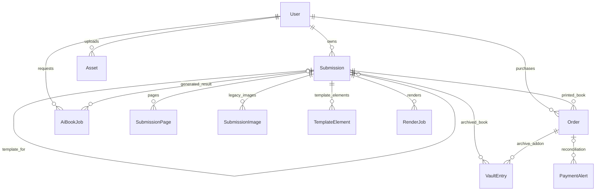

# Database Schema Audit — Phase 0

Audit date: November 17, 2026. Read-only findings; no schema or data changes.

## Evidence and scope

Sources: [Prisma schema](../../prisma/schema.prisma), the 15 repository
migrations, and PostgreSQL catalogs for columns, constraints, indexes, enums,
tables, roles and policies. Catalog/configuration/aggregate inspection used
transactions explicitly set to `READ ONLY`. No credentials, password hashes,
reset tokens, payment addresses or private manuscript contents are reproduced.

Configured database: Neon PostgreSQL 17.12, `neondb`; connected role
`neondb_owner`, `rolsuper=false`, `rolbypassrls=true`. The catalog contains 14
application tables plus `_prisma_migrations` in `public` and nine tables in
`neon_auth`. This is not a disposable local database. Column/key inventories
were reconciled with source; a formal migration-diff/checksum attestation was
not executed.

## Reading the inventory

All columns are listed below. `?` means nullable; an omitted default means no
database default. `text`, `int`, `bool`, `float8`, `jsonb` mean PostgreSQL text,
integer, boolean, double precision and JSONB. `ts` means application
timestamp(3) without time zone; `tstz` means timestamp with time zone. Enum
types are listed separately.

For application tables, `id: text PK` is generated by Prisma `cuid()` unless
noted; it has no SQL default. `createdAt: ts = now()` is a database default.
`updatedAt: ts` is maintained by Prisma `@updatedAt`, not a database update
trigger. JSON held in `text` columns is not database-validated JSON. Relation
arrays in Prisma are not stored columns.

## Application table and column inventory

### User

| Columns              | Type / nullability / default             |
| -------------------- | ---------------------------------------- |
| id                   | text PK; Prisma cuid                     |
| email                | text, unique                             |
| passwordHash         | text                                     |
| name                 | text?                                    |
| role                 | UserRole = USER                          |
| passwordResetToken   | text?; application stores a token digest |
| passwordResetExpires | ts?                                      |
| createdAt            | ts = now()                               |
| updatedAt            | ts                                       |

No email-verification, public author profile, organization membership, payout
identity, account suspension or session-version column exists. Email uniqueness
is not an explicitly case-insensitive constraint. Deprecated business
registration columns are absent.

### Submission

| Columns                                 | Type / nullability / default          |
| --------------------------------------- | ------------------------------------- |
| id                                      | text PK                               |
| userId                                  | text FK User                          |
| mode                                    | SubmissionMode = LEGACY_UPLOAD        |
| title                                   | text?                                 |
| status                                  | SubmissionStatus = PENDING            |
| pdfS3Key, readingPdfS3Key, previewS3Key | text? each                            |
| artifactManifest                        | jsonb?                                |
| rejectionReason                         | text?                                 |
| editorVersion                           | int = 1                               |
| revision                                | int = 0                               |
| submittedAt                             | ts?                                   |
| templateId                              | text? self-FK                         |
| templateVersion                         | int?                                  |
| isTemplate                              | bool = false                          |
| version                                 | int = 1; template publication counter |
| publishedAt                             | ts?; template publication timestamp   |
| aiReady                                 | bool = false                          |
| aiManifest, pinnedTemplate              | jsonb? each                           |
| managedKey                              | text?, unique                         |
| aiGenerated, qaSampled                  | bool = false each                     |
| createdAt                               | ts = now()                            |
| updatedAt                               | ts                                    |

The same table stores ordinary books, templates, and template instances.
`status=APPROVED` can originate from administrator review or AI technical QA. It
does not imply public listing, verified copyright, or a publishing license.

### SubmissionImage

`id: text PK`; `submissionId: text FK Submission`; `pageLabel: text`;
`s3Key: text`; `order: int`; `originalFilename: text`; `mimeType: text`;
`createdAt: ts = now()`.

Legacy eight-upload path. Page count, allowed labels and distinctness are
application checks, not unique constraints here.

### SubmissionPage

`id: text PK`; `submissionId: text FK Submission`; `pageLabel: text`;
`order: int`; `sceneJson: text = '{}'`; `revision: int = 0`;
`previewS3Key: text?`; `renderedPageS3Key: text?`; `createdAt: ts = now()`;
`updatedAt: ts`.

Unique `(submissionId,pageLabel)` and `(submissionId,order)`. Editor
element/asset references reside inside JSON text, not foreign keys.

### Asset

`id: text PK`; `userId: text FK User`; `s3Key: text UNIQUE`;
`originalFilename: text`; `mimeType: text`; `width: int?`; `height: int?`;
`fileSize: int`; `createdAt: ts = now()`; `updatedAt: ts`.

No relational use/reference count, source-byte digest, immutable S3 version
identity or retention state exists.

### Order

| Columns                                               | Type / nullability / default              |
| ----------------------------------------------------- | ----------------------------------------- |
| id                                                    | text PK                                   |
| userId                                                | text FK User; buyer                       |
| submissionId                                          | text FK Submission; exactly one book      |
| quantity, weightGrams, shippingBand                   | int each                                  |
| zone                                                  | text                                      |
| vaultAddOn                                            | bool = false                              |
| vaultFeeHuf                                           | int = 0                                   |
| unitPriceHuf, printCostHuf, shippingCostHuf, totalHuf | int each                                  |
| handlingCostHuf, discountHuf                          | int = 0 each                              |
| currency                                              | text = HUF                                |
| status                                                | OrderStatus = PENDING_PAYMENT             |
| pricingConfigVersion                                  | int                                       |
| stripeSessionId                                       | text?, unique                             |
| paidAt                                                | ts?                                       |
| recipientName, line1, city, postalCode, countryCode   | text each                                 |
| line2, phone                                          | text? each                                |
| fulfilmentHub, couponCode, parentBatchId              | text? each; currently unused placeholders |
| notes                                                 | text?                                     |
| createdAt                                             | ts = now()                                |
| updatedAt                                             | ts                                        |

Amounts are HUF snapshots, not necessarily the foreign-currency amount
collected. No FX factor, expected Stripe minor amount, PaymentIntent, per-item
tax/refund, or payment-attempt history is stored. Required single-book/address
fields cannot represent a digital-only/mixed order without an additive
compatibility transition.

### TemplateElement

`id: text PK`; `templateId: text FK Submission`; `pageLabel: text`;
`order: int`; `elementJson: text`; `createdAt: ts = now()`; `updatedAt: ts`.

No unique `(templateId,pageLabel,order)` constraint. The parent is a Submission;
the database does not require `isTemplate=true`.

### PricingConfig

`id: text PK = 'default'`; `version: int = 1`; `weightPerBookGrams: int = 6`;
`handlingFixedHuf: int = 0`; `handlingPercent: float8 = 0`;
`enabledZones: text`; `weightBands: text`; `shippingTable: text`;
`priceTiers: text`;
`currencyRates: text = '{"HUF":1,"EUR":0.0026,"GBP":0.0022}'`;
`vaultFeeHuf: int = 2000`; `updatedAt: ts`; `updatedByUserId: text?`.

A mutable singleton with JSON strings; `updatedByUserId` has no FK. Incrementing
`version` does not retain older configurations. Existing floating-point
configuration should not be silently reinterpreted during migration.

### VaultEntry

`id: text PK`; `orderId: text FK Order`; `submissionId: text FK Submission`;
`title: text`; `authorName: text`; `quantity: int = 2`;
`status: VaultEntryStatus = STORED`; `publicConsent: bool = false`;
`storedAt: ts = now()`; `withdrawnAt: ts?`; `createdAt: ts = now()`;
`updatedAt: ts`.

No unique `orderId`. Application find-then-create is insufficient as the only
concurrent uniqueness guarantee. Name and consent authority currently assume
purchaser equals author. `STORED` is assigned at settlement, not backed by a
warehouse receipt event.

### AiBookJob

| Columns                             | Type / nullability / default |
| ----------------------------------- | ---------------------------- |
| id                                  | text PK                      |
| userId                              | text FK User                 |
| concept                             | text                         |
| templateId                          | text?; no declared FK        |
| submissionId                        | text? FK Submission          |
| renderJobId                         | text?; no declared FK        |
| status                              | AiBookJobStatus = QUEUED     |
| stage                               | AiBookStage = CONCEPT        |
| stageOutput                         | jsonb?                       |
| attempts, failureCount, repairCount | int = 0 each                 |
| maxAttempts                         | int = 3                      |
| maxRepairs                          | int = 2                      |
| deadlineAt                          | ts?                          |
| requestKey, payloadDigest           | text? each                   |
| nextAttemptAt                       | ts = now()                   |
| leaseExpiresAt                      | ts?                          |
| claimToken, errorMessage            | text? each                   |
| startedAt, completedAt              | ts? each                     |
| createdAt                           | ts = now()                   |
| updatedAt                           | ts                           |

Unique `(userId,requestKey)` permits multiple historical NULL request keys.
`attempts` is claim telemetry, not failure budget. Preserve these semantics.

### RenderJob

`id: text PK`; `submissionId: text FK Submission`;
`status: RenderJobStatus = QUEUED`; `attempts: int = 0`; `maxAttempts: int = 3`;
`inputSnapshot: jsonb?`; `nextAttemptAt: ts = now()`; `leaseExpiresAt: ts?`;
`claimToken: text?`; `errorMessage: text?`; `pdfS3Key: text?`;
`readingPdfS3Key: text?`; `artifactManifest: jsonb?`; `startedAt: ts?`;
`completedAt: ts?`; `createdAt: ts = now()`; `updatedAt: ts`.

Render history and frozen input are valuable, but they are not an immutable
commercial version/file registry.

### QueueDrainRun

`id: text PK`; `queue: text`; `startedAt: ts`; `finishedAt: ts`;
`durationMs: int`; `claimed: int`; `finished: int`; `yielded: int`;
`errored: bool = false`; `createdAt: ts = now()`.

Queue names are string conventions. `finished` counts settled processing, not
necessarily successful books. Records are operational heartbeats with retention,
not a permanent event ledger.

### RateLimitBucket

`bucketKey: text PK` (application-supplied, no cuid); `windowStart: ts`;
`count: int`; `expiresAt: ts`.

Durable fixed-window counters; no new rate-limit store is needed merely for
marketplace endpoints.

### PaymentAlert

`id: text PK`; `orderId: text? FK Order`; `kind: text`; `message: text`;
`context: text?`; `dedupeKey: text UNIQUE`; `occurrences: int = 1`;
`firstSeenAt: ts = now()`; `lastSeenAt: ts = now()`; `resolvedAt: ts?`.

Mutable deduplicated operational alerts, including stale paid sessions, unpaid
completion and failed vault creation. They are not accounting entries and
currently cascade on order deletion.

## Enums and status constraints

| PostgreSQL type  | Values                                                              |
| ---------------- | ------------------------------------------------------------------- |
| UserRole         | USER, ADMIN                                                         |
| SubmissionMode   | LEGACY_UPLOAD, EDITOR, TEMPLATE                                     |
| SubmissionStatus | DRAFT, PENDING, APPROVED, REJECTED, PROCESSING, FAILED              |
| OrderStatus      | PENDING_PAYMENT, PAID, IN_PRODUCTION, SHIPPED, DELIVERED, CANCELLED |
| VaultEntryStatus | STORED, WITHDRAWN, CANCELLED                                        |
| AiBookJobStatus  | QUEUED, PROCESSING, COMPLETED, FAILED                               |
| AiBookStage      | CONCEPT, CONTENT, COMPOSE, RENDER, QA                               |
| RenderJobStatus  | QUEUED, PROCESSING, COMPLETED, FAILED                               |

Enums constrain allowed values, not legal state transitions.
`PaymentAlert.kind`, `QueueDrainRun.queue`, shipping zones, currencies and page
labels are strings. No CHECK constraints appeared in inspected public/neon_auth
catalogs. Nonnegative amounts, valid quantities, same-owner template/version
relationships and workflow invariants largely depend on application code.

## Keys, relationships and index inventory

Every application table has its listed PK index. The following is the complete
non-PK application index/uniqueness inventory; column lists are ordered.

| Table           | Unique indexes                             | Other indexes                                                     |
| --------------- | ------------------------------------------ | ----------------------------------------------------------------- |
| User            | email                                      | none                                                              |
| Submission      | managedKey                                 | userId; isTemplate; templateId                                    |
| SubmissionImage | none                                       | submissionId                                                      |
| SubmissionPage  | submissionId,pageLabel; submissionId,order | submissionId                                                      |
| Asset           | s3Key                                      | userId                                                            |
| Order           | stripeSessionId                            | userId; submissionId; status                                      |
| TemplateElement | none                                       | templateId; templateId,pageLabel                                  |
| PricingConfig   | none beyond PK                             | none                                                              |
| VaultEntry      | none                                       | submissionId; status                                              |
| AiBookJob       | userId,requestKey                          | userId; submissionId; status,nextAttemptAt; status,leaseExpiresAt |
| RenderJob       | none                                       | submissionId; status; status,nextAttemptAt; status,leaseExpiresAt |
| QueueDrainRun   | none                                       | queue,startedAt; createdAt                                        |
| RateLimitBucket | none                                       | expiresAt                                                         |
| PaymentAlert    | dedupeKey                                  | resolvedAt,lastSeenAt; orderId                                    |

Application FK constraints use `ON UPDATE CASCADE`. Delete actions:

| Child FK                                                            | Parent        | On delete |
| ------------------------------------------------------------------- | ------------- | --------- |
| Submission.userId; Asset.userId; Order.userId; AiBookJob.userId     | User.id       | RESTRICT  |
| Submission.templateId                                               | Submission.id | SET NULL  |
| SubmissionImage.submissionId; SubmissionPage.submissionId           | Submission.id | CASCADE   |
| TemplateElement.templateId                                          | Submission.id | CASCADE   |
| Order.submissionId; RenderJob.submissionId; VaultEntry.submissionId | Submission.id | RESTRICT  |
| AiBookJob.submissionId                                              | Submission.id | SET NULL  |
| VaultEntry.orderId                                                  | Order.id      | RESTRICT  |
| PaymentAlert.orderId                                                | Order.id      | CASCADE   |

Not FK-backed: `PricingConfig.updatedByUserId`, `AiBookJob.templateId`,
`AiBookJob.renderJobId`, scene asset references and S3 keys. Some are deliberate
compatibility fields; adding constraints requires orphan analysis, not
assumptions.

PricingConfig, QueueDrainRun and RateLimitBucket are standalone tables. This
diagram describes today's schema, not future marketplace entities.

## Migration metadata and history

`public._prisma_migrations`: `id: varchar PK`; `checksum: varchar`;
`finished_at: tstz?`; `migration_name: varchar`; `logs: text?`;
`rolled_back_at: tstz?`; `started_at: tstz = now()`;
`applied_steps_count: int = 0`. It is managed by Prisma, not an application
model.

| Repository migration                                 | Purpose                                                                   |
| ---------------------------------------------------- | ------------------------------------------------------------------------- |
| 20260601062824_init                                  | Users, submissions/pages/images/assets, orders, templates, pricing        |
| 20260601120033_add_password_reset_fields             | Reset digest/expiry                                                       |
| 20260604085357_add_vault_storage                     | Order archive add-on and VaultEntry                                       |
| 20260921090000_repair_business_and_render_jobs       | Historical business repair and render jobs                                |
| 20260921091000_durable_queue_and_revisions           | Revisions, render snapshots, leases and due indexes                       |
| 20260929090000_add_ai_book_jobs                      | AI queue and submission AI flags                                          |
| 20261020090000_add_vault_public_consent              | Private-by-default vault consent                                          |
| 20261020100000_add_rate_limit_buckets                | Durable throttles                                                         |
| 20261020110000_add_order_payment_fields              | Stripe session and paid timestamp                                         |
| 20261021100000_add_queue_drain_runs                  | Scheduler heartbeat history                                               |
| 20261021110000_add_status_enums                      | Eight native enum types                                                   |
| 20261024090000_ai_finished_books                     | Dual artifacts, AI/template manifests, repair/deadline/idempotency fields |
| 20261024120000_add_template_managed_key              | Seed-owned template identity                                              |
| 20261110090000_add_payment_alerts                    | Durable reconciliation alerts                                             |
| 20261110100000_drop_deprecated_user_business_columns | Removed historical business fields                                        |

Database metadata had 16 history rows for 15 distinct migrations: a rolled-back
failed repair attempt and a subsequent finished resolution are both retained.
All 15 names have finished rows, but some report zero applied steps. This is
history evidence, not permission to replay/resolve migrations or proof that
every statement was executed by Prisma. The last four finished on November 14,
2026 in the queried database. Preserve original migration files and metadata.

## Additional neon_auth schema — preserve separately

Nine tables exist outside Prisma's declared models. The inspected NextAuth
credentials code uses `public.User`, not these identities. All nine have UUID
`id` PKs defaulting to `gen_random_uuid()`. Fields below are required unless
`?`; all names retain database casing. Sensitive column names are documented,
but their values were not read.

| Table          | Remaining columns                                                                                                                                                                                                    |
| -------------- | -------------------------------------------------------------------------------------------------------------------------------------------------------------------------------------------------------------------- |
| user           | name text; email text UNIQUE; emailVerified bool; image text?; createdAt/updatedAt tstz = now(); role text?; banned bool?; banReason text?; banExpires tstz?                                                         |
| account        | accountId text; providerId text; userId uuid FK user; accessToken/refreshToken/idToken text?; accessTokenExpiresAt/refreshTokenExpiresAt tstz?; scope/password text?; createdAt tstz = now(); updatedAt tstz         |
| session        | expiresAt tstz; token text UNIQUE; createdAt tstz = now(); updatedAt tstz; ipAddress/userAgent text?; userId uuid FK user; impersonatedBy/activeOrganizationId text?                                                 |
| verification   | identifier text; value text; expiresAt tstz; createdAt/updatedAt tstz = now()                                                                                                                                        |
| organization   | name text; slug text UNIQUE; logo text?; createdAt tstz; metadata text?                                                                                                                                              |
| member         | organizationId uuid FK organization; userId uuid FK user; role text; createdAt tstz                                                                                                                                  |
| invitation     | organizationId uuid FK organization; email text; role text?; status text; expiresAt tstz; createdAt tstz = now(); inviterId uuid FK user                                                                             |
| jwks           | publicKey text; privateKey text; createdAt tstz; expiresAt tstz?                                                                                                                                                     |
| project_config | name text; endpoint_id text UNIQUE; created_at/updated_at tstz = now(); trusted_origins/social_providers jsonb; email_provider/email_and_password jsonb?; allow_localhost bool; plugin_configs/webhook_config jsonb? |

All six declared neon_auth FKs delete-cascade: account.userId, session.userId,
member.userId, member.organizationId, invitation.inviterId,
invitation.organizationId. No FK links these users to public.User. Every table
has a PK; additional indexes:

- account: userId.
- invitation: email; organizationId.
- member: organizationId; userId.
- session: userId; unique token.
- verification: identifier.
- user: unique email.
- project_config: unique endpoint_id.
- organization: both `organization_slug_key` and `organization_slug_uidx`
  uniquely index slug; apparent redundancy is not authorization to remove
  either.
- jwks: PK only in inspected inventory.

Initial statistics estimated zero rows in these tables except project_config
(one). These are estimates, not exact counts or evidence they are unused
externally. Provider ownership, integrations, grants and deletion policy must be
established separately before any change. Do not absorb or drop this schema as
migration drift.

## Existing records — non-personal snapshot

| Application table | Exact row count at inspection |
| ----------------- | ----------------------------: |
| User              |                             8 |
| Submission        |                            48 |
| SubmissionImage   |                             0 |
| SubmissionPage    |                           384 |
| Asset             |                             4 |
| Order             |                             1 |
| TemplateElement   |                            52 |
| PricingConfig     |                             1 |
| VaultEntry        |                             0 |
| AiBookJob         |                            22 |
| RenderJob         |                            14 |
| QueueDrainRun     |                             4 |
| RateLimitBucket   |                             4 |
| PaymentAlert      |                             0 |

Submission totals: 20 APPROVED and 28 DRAFT. Six are templates (three AI-ready,
three not). Among 42 non-template books, 14 are approved: 13 have print/reading
keys and manifest; one has a print key only. The remaining 28 are drafts without
those artifact references. Key presence is not proof that the corresponding
object exists or matches its digest.

AI jobs: 13 COMPLETED, nine FAILED. Render jobs: 14 COMPLETED. These counts are
not a diagnosed failure rate or a benchmark.

The only order is PENDING_PAYMENT, quantity 40, `totalHuf=7565`, `currency=EUR`,
pricing config version 1, `paidAt=NULL`. This is **not collected revenue**.
There are no paid/vault rows with which to establish a live financial settlement
history. No historic royalties or entitlements exist to import.

PricingConfig remains version 1 with the old five-zone, 2 kg ladder and older
quantity tiers; see [actual values and formulas](PAYMENT_AND_PRINTING_AUDIT.md).

## Access policy and integrity assessment

`pg_policies` returned no policies. All 24 inspected regular tables have
`relrowsecurity=false` and `relforcerowsecurity=false`. The connected owner role
bypasses RLS. API/service ownership and ADMIN checks are the effective
application policy; no browser database access was found. This is an
access-control design to strengthen, not evidence of a public database or a
proven data breach.

Priority integrity gaps:

1. No item/payment/refund/entitlement/royalty provenance; mutable pricing
   version cannot recreate past rates.
2. No DB-enforced unique vault entitlement per existing order.
3. Asset references and historical object versions are not relationally
   retained.
4. Deleting a template sets instance.templateId NULL and cascades template
   elements; generic draft deletion bypasses a dedicated template guard.
5. Enum membership does not enforce legal transitions, sums, nonnegative
   quantities or valid country/zone selection.
6. Growing catalog/ledger queries require purpose-built composite indexes and
   pagination; existing single-column indexes are not a catalog design.
7. Transaction timestamps require an explicit UTC convention; do not reinterpret
   legacy values during a bulk type conversion.

## Extend versus add

**Extend/preserve:** User identity; Submission book identity and content;
pages/templates/assets; RenderJob/AiBookJob queues; Order header/history;
PricingConfig entry point; VaultEntry; payment alerts and rate limits.

**Add only for genuinely new responsibilities:** public author
profiles/listings, immutable approved publication versions and file references,
versioned terms/settings, OrderItem and immutable quotes/payment history/refund
allocations, customer download entitlements, fulfillment/production records,
royalty and payout records, sponsor/charity/outlet profiles and memberships,
campaign/edition/panel inventory, distribution and QR records.

The [proposed architecture](PROPOSED_ARCHITECTURE.md) maps “publication” to the
existing Submission identity rather than creating a duplicate Books table. The
[migration plan](DATABASE_MIGRATION_PLAN.md) preserves legacy IDs and defaults
everything private; it contains no executable migration and grants no deployment
approval.
