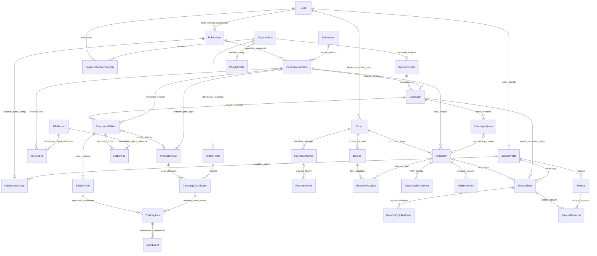

# Proposed Architecture — Phase 0 Approval Proposal

Date: November 17, 2026. Everything in this document is proposed, not
implemented. Read with the [current architecture](CURRENT_ARCHITECTURE.md),
[migration plan](DATABASE_MIGRATION_PLAN.md) and
[approval questions](RISKS_AND_DEPENDENCIES.md).

## 1. Architecture decision

Retain Next.js/React, TypeScript, Prisma/PostgreSQL on Neon, NextAuth, S3,
Stripe, Resend and OpenAI. Evolve the modular monolith through cohesive service
modules and existing route/UI conventions. No framework migration,
microservices, second order store, second pricing engine, Supabase conversion or
new queue product is justified by this audit.

**Identity decision:** the brief's original “book/publication” maps to an
existing non-template **Submission.id**, not a new Books table. A new
PublicationListing holds commercial metadata; PublicationVersion holds immutable
approved-version provenance. Neither duplicates manuscript/page content.
Existing IDs, owners, scene data, approved PDFs, orders and private access
survive.

A root Submission remains the original book. Add nullable `publicationRootId` on
explicitly derived version drafts; root records have NULL. New version creation
reuses `duplicateAsDraft`, then associates the copy to its root and source
version. No automatic grouping of old copies by title. Root/source must be
non-template submissions owned by the same user; roots cannot form
chains/cycles. The approved root's content is never edited to create a new
version.

## 2. Relationship diagram

`Publication` below is the conceptual role of the **existing root Submission**,
not a proposed duplicate publication table. New names denote domain records to
be introduced incrementally.

Diagram constraints not expressible by the connectors: a production target is
exactly one ordinary version or sponsored edition; commercial fee lines differ
from physical/PDF lines; an edition has exactly eight slots (occupied or
vacant); every royalty has a unique originating economic event. Campaign money
is recorded through Order/payment records, not a competing campaign payment
system.

## 3. Domain modules and reuse

| Domain              | Preserve                                               | Proposed extension                                                                                          |
| ------------------- | ------------------------------------------------------ | ----------------------------------------------------------------------------------------------------------- |
| Identity/policies   | NextAuth, User, origin protection, throttles           | Verified email, session revocation, author profiles, organization membership and explicit resource policies |
| Authoring           | Submission/pages/assets, editor, template/AI flow      | Explicit root/version draft linkage; no commercial logic inside canvas components                           |
| Publication/catalog | Owner dashboard, admin moderation, thumbnails          | Listing lifecycle, version review, categories/tags/language, approved public samples and author identity    |
| Files               | RenderJob, frozen snapshots, manifest and S3 signing   | Immutable FileRecord references, retention/ref tracking, qualification and purchased access policy          |
| Pricing/commerce    | PricingConfig/engine, OrderPanel, Order, Stripe        | Versioned central settings, quotes, items, payment history, refunds, entitlements and fulfillment           |
| Earnings            | Existing admin shell and alert patterns                | Immutable royalties, eligibility, payout allocations and reconciled reports                                 |
| Sponsorship         | Existing author/version and price/render services      | Organizations, campaigns, quotes, independent editions and panel inventory                                  |
| Distribution        | Existing identity/admin/UI primitives                  | Outlet directory, allocation/dispatch/stock events, replenishment and QR engagement                         |
| Operations          | Durable leases, queue monitor, CI and backup workflows | Notification/outbox delivery, reconciliation jobs, audit trail, retention and service readiness checks      |

Use modules under the existing `src/lib` organization with thin route handlers.
Extract shared policy/transaction boundaries where necessary; do not perform a
blanket refactor of working editor/AI internals. Existing UI components remain
the entry point for owner printing and administration.

## 4. Publication, versions, rights and catalog

### Records and invariants

- **AuthorProfile:** one per User; public slug/display name/biography/approved
  website/image. Public APIs expose slug and approved metadata, not email or
  User.id. Private payment/tax data is separate.
- **PublicationVersion:** root Submission FK, source Submission FK, source
  revision, ordinal, render job if known, frozen scene/template manifest,
  artifact qualification/provenance and commercial review projection. Unique
  `(rootSubmissionId,versionNumber)` and `(sourceSubmissionId,sourceRevision)`.
  Frozen content/file associations never change after approval.
- **PublicationReview:** append-only reviewer/decision/time/reason and reviewed
  version/digest. AI technical approval is provenance, not this commercial
  content-rights approval.
- **PublicationListing:** unique root Submission FK, active approved version,
  slug, title/subtitle/description, author profile, language, availability
  (print/PDF), sponsorship eligibility, featured flag and reference to
  commercial terms/prices. Metadata revisions requiring moderation cannot
  silently change the already-approved public representation.
- **Category**, **PublicationCategory**, **Tag**, **PublicationTag:** normalized
  admin-managed catalog taxonomy; unique slugs and join keys.
  Published/status/language/category/date indexes and bounded cursor pagination
  support thousands of publications. Start with PostgreSQL search; add a
  weighted full-text index before broad catalog growth, not an external search
  service by default.
- **TermsVersion** and **RightsAcceptance:** immutable
  publishing/digital/campaign terms versions, consenting identity/time,
  publication/version, agreement digest and explicit content-rights
  confirmation. Author retains copyright. Legal text is supplied/approved by the
  business, not invented by the application.
- **FileRecord** with version/edition/source-reference joins: object key,
  optional provider version ID, digest, bytes, MIME, kind, profile, provenance
  and validation status. Multiple associations may reference the same retained
  bytes; do not copy PDFs merely to list them.

Proposed commercial review: UNREVIEWED → IN_REVIEW → APPROVED or REJECTED, with
withdrawal/review history retained. Proposed listing status: PRIVATE,
PENDING_REVIEW, PUBLISHED, SUSPENDED, UNPUBLISHED, REMOVED. REMOVED means
listing tombstone, not deletion of book/files/sales. Existing SubmissionStatus
stays intact for authoring/rendering.

Publishing requires owner opt-in, approved rights acceptance, commercial version
approval, valid price/format configuration and verified corresponding master.
Listing suspension blocks new purchases/sponsorship enquiries but does not
automatically revoke lawful historic customer rights. Legal takedown/revocation
must be explicit, reasoned and audited.

No listing or public author profile is automatically activated during migration.
Importing a legacy technical artifact is not new legal consent. A historical
print-only book can be qualified for the appropriate formats without inventing a
reading artifact; current owner download/print access remains compatible.

Public pages: shop browse/search/filter/featured/new, book detail with approved
samples, and author pages. Popularity counts real settled eligible sales with
refund adjustments, excluding test/self purchases; never views or QR scans.
Public DTOs and separately approved sample images must never expose masters,
private scenes or raw owner identifiers.

## 5. One commerce and pricing system

### Central commercial configuration

Keep PricingConfig as the current print-pricing entry point. Introduce immutable
**CommercialConfigVersion** snapshots with validated domains for print
tiers/costs, shipping/country-carrier mappings, FX, retail/PDF prices, tax
inputs, royalties, sponsorship components, payout thresholds, minimum quantities
and panel rules. An admin change archives a new version and updates the active
legacy-compatible projection in one transaction. Existing values are imported as
observed, not replaced by bootstrap defaults.

A single server quotation service composes existing engine primitives.
Per-publication price/commission overrides refer to versioned commercial terms;
they do not implement independent arithmetic. UI previews are non-authoritative.
Quotes retain input digest, config/terms versions, HUF components, currency, FX
factor/source/time, tax basis, expected provider minor units, rounding version
and expiry.

Proposal for approval: quantity tiers apply to each publication/version print
line; aggregate all physical weight once for one supported parcel; digital/fee
lines add zero parcel weight. Oversize/unqualified routes go to manual quote;
multi-parcel optimization is deferred. Packaging weight is configurable and must
be approved. Use configured fixed-per-copy commissions first; future percentage
terms can be represented without activating them.

Keep legacy HUF fields as whole-forint integers. New provider amounts use
integer minor units; new FX/percentage storage uses exact decimal representation
(proposed `Decimal(20,10)` FX), not JavaScript floating-point accumulation.
Bound arithmetic and define largest-remainder allocation for
cross-currency/refund line rounding so item components reconcile to the charge.
New monetary ledger storage should use bigint-sized amounts with string
serialization at API boundaries. No automatic change to historical rounding.

### Order and checkout

- Extend **Order**, preserving ID/buyer/history and legacy snapshots. Add
  origin/schema version, verified contact snapshot and payment-state projection.
  Legacy single-book/address fields become nullable only after all consumers
  tolerate mixed/digital orders; do not fill them with a made-up “first book.”
- Add **OrderItem** for immutable version-pinned PRINT/PDF products and
  explicitly typed service/fee lines (vault, sponsorship, panel fee). A fee line
  references its accepted campaign quote/terms, not fake physical copies. Store
  quantity, author/payee, title, unit/total/discount/tax/cost and royalty-rate
  snapshots.
- Reuse the owner print interface as a single-item adapter. Marketplace clients
  use the same quote/order/settlement services with a different authorization
  policy: anyone may buy a currently eligible listing; authors may still
  self-print privately.
- Persist **CheckoutQuote**, **PaymentAttempt**, **PaymentEvent**, **Refund**,
  **RefundAllocation** and **OutboxEvent**. Unique request keys, quote
  consumption, provider session/payment IDs and event IDs establish replay
  boundaries.
- A new quote is valid for a configured interval (proposed 15 minutes to
  accept); an accepted order then pins its amount for the associated Checkout
  lifetime. Retries never consult new FX. Repricing requires explicit acceptance
  of a replacement quote/order linked to the superseded unpaid order; no silent
  mutation. Expire/reconcile older sessions and handle late real payments before
  release of additional goods.
- Stripe network calls occur outside DB transactions, with durable pending
  attempt state and deterministic provider idempotency keys. Retry can recover a
  created-but-unlinked session. Provider callbacks update one shared settlement
  service used by manual settlement with explicit evidence.
- Validate signature, provider mode/account, expected attempt/order, paid state,
  currency and amount. Record every actual payment, including extra/late
  payments; deduplicate goods and raise reconciliation alerts for overpayment,
  cancellation or mismatch.
- The settlement transaction writes payment outcome and unique
  entitlement/royalty/outbox intents atomically. Email failure never rolls back
  money or loses notification; an outbox worker retries. Refunds and disputes
  have append-only economic records, item allocations and audit reasons.

Use an identifiable authenticated customer for initial PDF checkout. Guest
physical checkout can use verified email and a scoped order-access link; guest
digital delivery must first verify that email or claim an account. Email text
alone is not authorization. Verification tokens are hashed/expiring/single-use,
not URL-embedded account IDs. No authentication-provider migration is required.

### Entitlements and fulfillment

**DownloadEntitlement** pins buyer/verified identity, OrderItem,
PublicationVersion and FileRecord plus accepted digital license. Unique per
purchased license, states ACTIVE/REVOKED with append-only event history.
Repeated download signs the same approved print master; do not resolve “latest
version.” New signing checks identity, settlement, license and revocation,
returns short-lived private URLs, and records minimal access metadata. Public
previews use separate approved assets.

**FulfilmentItem**, **Shipment**, **ShipmentItem**, **ProductionRun** and
**ProductionRunItem** record physical quantities and immutable print targets.
Partial shipments/delivery are explicit, with totals never exceeding paid
production quantities. Order's overall view is derived from payment plus
per-item state; the legacy OrderStatus remains a compatibility projection for
old single-book orders, not the authoritative mixed-order state machine.

Vault remains an optional physical service. Preserve existing entries/consent;
attach new service purchases to the relevant order item/version, use author
identity for public credit, and record physical receipt separately from paid
entitlement. Do not let a retail buyer consent on the author's behalf. Apply DB
uniqueness to legacy order-level and new item-level archive entitlements.

## 6. Author royalties and manual payouts

**RoyaltyAgreementVersion** captures fixed print/PDF per-copy rates and
campaign-specific alternatives; 50/150 HUF examples are not seeded rates.
Validate nonnegative commercial margin/authorized exceptions before selling.
Self-purchases have explicit ineligible provenance, not earnings funded by
buying one's own work; broader related-party controls remain a business policy
dependency.

**RoyaltyEntry** is append-only financial data: author, root/version, order/item
or funded campaign source, format, quantity, immutable
agreement/rate/FX/currency, signed amount, timestamp, entry kind and unique
economic source key. Initial sale accrual is pending.
**RoyaltyEligibilityEvent** records evidence-based availability without
rewriting the original economics:

- PRINT: paid and documented delivered quantity (proposed initial definition of
  fulfilled).
- PDF: settled payment and successful entitlement grant, not each download.
- Campaign: accepted agreement's milestone/quantity tied to its funded
  transaction/production evidence.
- Refund/cancellation after accrual: linked negative entries; partial
  adjustments use original rates and allocation, not current settings.

Exactly once means once per economic source, including distinct partial-delivery
events, not once per HTTP request. Unique constraints plus row locking protect
replay. Disputed funds are held from payout; already-paid reversals become a
visible negative balance/recovery case, never deleted history.

**Payout** records request, author, currency, threshold/config version, approved
amount, manual transfer evidence/reference, approver and paid time.
**PayoutAllocation** links the individual eligible royalty amounts settled.
Reserve balances transactionally per author/currency; prevent overlapping
allocations and payout above availability. Financial postings/paid allocations
cannot be edited; errors use compensating records. Payout metadata may progress
through REQUESTED/APPROVED/PROCESSING/PAID/FAILED/CANCELLED with audit events.

Earnings views show lifetime, pending, available, paid, reversed,
per-publication/format/date history and CSV exports. Reports must reconcile by
currency and distinguish gross sales, costs, liabilities and transfers. Private
tax/payment details use restricted storage and access. Manual bank payouts are
initial scope; Stripe Connect is an adapter extension only after
accounting/compliance approval.

Stage 2 must capture royalty terms and source events; Stage 3 supplies
accrual/settlement/reporting before real marketplace sales are enabled. There
must not be an interim live launch that loses author earnings.

## 7. Sponsors, campaigns and immutable editions

Reuse User identity through **Organization** and **OrganizationMembership**. Add
approved **SponsorProfile**, **OutletProfile** (location-specific), and
**CharityProfile** capabilities. Do not resurrect deprecated business fields on
User or confuse business membership with global ADMIN. Organizations may play
multiple roles; each capability has its own approval and private/public
projection.

**CampaignEnquiry** captures sponsor interest or an author's suggested sponsor,
publication/version and audience/industry fit. An enquiry is not permission to
contact a business automatically. **Campaign** references approved sponsor and
an approved source PublicationVersion, with quantity, schedule,
commercial/artwork/production projections. **CampaignQuote** versions freeze
full price/cost/royalty/tax/distribution/panel-fee breakdown and acceptance
evidence. Payment routes through existing Order and Stripe; a placement fee is
not recorded as a charitable donation.

Proposed campaign progression:
`DRAFT → SUBMITTED → UNDER_REVIEW → QUOTED → APPROVED → AWAITING_PAYMENT → PAID → ARTWORK_APPROVED → PRODUCTION_READY → PRINTING → DISPATCHED → COMPLETED`,
plus revision/rejection/cancellation transitions. Payment, artwork and
production evidence remain separate; a UI status alone cannot release printing.
Quote changes after acceptance require a new accepted revision and financial
reconciliation.

**SponsoredEdition** has its own ID, campaign, source approved version, edition
revision, frozen artwork/panel manifest, approved file set, profile and
approver. Multiple campaigns may use the same original; a campaign can retain
successive artwork revisions while selecting one final edition. Original scenes,
Submission PDF keys and sold PublicationVersions are never updated by edition
rendering.

Extend RenderJob with an explicit edition target and snapshot discriminator
while preserving existing submission jobs and completion logic. Each job targets
exactly one ordinary submission or edition. Retain common lease/fencing/storage
primitives; edition publication writes only edition file references. A separate
sponsored print profile is mandatory. Physical reverse-side/imposition proof is
an approval dependency, not an assumed implemented eight-panel feature.

### Eight-position inventory

Create eight **EditionPanel** rows, positions 1–8, in the same transaction as a
new edition. Unique `(editionId,position)` and a 1–8 CHECK prevent
duplicate/out-of-range positions. A deferred inventory constraint verifies
exactly eight at transaction commit; service code alone or uniqueness alone is
not enough to guarantee count. Do not delete individual slots.

Each slot is VACANT/RESERVED/AWAITING_APPROVAL/APPROVED, with revision,
reservation expiry, type, typed beneficiary FK, heading/description, approved
URL/QR, artwork reference and approval evidence. Conditional reservation updates
prevent concurrent allocation; expired reservations release through an audited
job. Slot types: charity, outlet, creator, additional sponsor, community
organization. An approved vacancy is valid inventory, not an error requiring
paid placement.

Charity identity permission and destination verification are versioned; outlet
participation does not grant placements on other editions. Paid placement
references its fee item/quote. Once final edition artwork is approved, changes
create a new edition revision with its own eight slots; historical allocations
and financial rights remain intact.

## 8. Distribution and engagement

**OutletProfile** includes approved public
location/category/coordinates/subjects/capacity and private contacts.
**CampaignDistribution** associates edition/production run/outlet, agreed
placement if any, allocated quantity and dates. **DistributionEvent** records
allocation adjustments, dispatch, delivery, loss and reported stock;
**ReplenishmentRequest** records requests/resolution. Dispatch cannot exceed
available produced stock; totals are protected by transactional allocation, not
only dashboard arithmetic. Reported remaining stock is an estimate distinct from
verified delivery/distribution.

A simple outlet portal exposes only membership-authorized locations,
participation, requests and contact changes. Sponsors see their campaigns and
approved aggregate reports, not outlet/customer private data or author bank
details.

**TrackingLink** has a unique unguessable public code,
edition/panel/campaign/source publication, typed beneficiary and optional
outlet-distribution variant, approved destination and destination-change audit
history. **ScanEvent** captures time and minimal anonymous/bot-classification
metadata with configured retention; aggregate into campaign/date counts. QR
rendering uses approved URLs and a qualified print-size/contrast policy.

Redirects resolve registered codes, not arbitrary `?url=` input. Restrict to
approved HTTPS destinations, review changed destinations, and provide a safe
suspended/expired response. Printed QR codes need a durable domain and routing
strategy. Scan counts are engagement only; real conversions/donations require
separate verified evidence. Promotional codes can link verified conversion
events but never infer donations from clicks.

Outernet/Memlocal use optional external-reference mappings and outbound event
adapters later. Distribution must function with no external directory available.

## 9. Permission and trust matrix

| Actor          | Allowed                                                       | Never implied                                                                           |
| -------------- | ------------------------------------------------------------- | --------------------------------------------------------------------------------------- |
| Anonymous      | Browse published listings/approved samples, safe QR redirects | Master PDFs, private account IDs, earnings or campaigns                                 |
| Author         | Own drafts/listings/rights; own earnings and payout requests  | Other authors' content/finances; unilateral approval of moderated listing/artwork       |
| Customer       | Own paid orders/licenses and permitted files                  | Author editor access, future latest files, public-vault consent for someone else's book |
| Sponsor member | Own approved organization's enquiries/campaigns/quotes        | Other campaigns, global admin or author payout information                              |
| Outlet member  | Own locations and distribution records/requests               | Other outlets or promotional rights without an edition-specific allocation              |
| Administrator  | Explicit moderation/finance/production operations with audit  | Unlogged financial edits or overwriting approved original content                       |
| Worker/webhook | Narrow authenticated job/settlement capabilities              | Public user session privileges or arbitrary object deletion                             |

Keep resource checks server-side on every route and shared service. Add session
version/account-state revalidation for sensitive actions, verified-email flow,
transactional token redemption and cache-private responses. Use a non-owner
runtime DB role and separate migration role; RLS can be defense-in-depth later,
but is not a substitute for these policies or an excuse to change providers.
`neon_auth` stays untouched pending separate ownership review.

## 10. Operations, growth and intentionally deferred scope

Use durable outbox/lease patterns for mail, reconciliation and edition work; add
consumer monitoring before new queues. Track correlation IDs
(order/attempt/event/version/edition/job), financial exceptions, missing
artifacts, backlog and scheduler freshness. Preserve existing alerts/admin queue
monitor. S3 retention/versioning, least-privilege policies, verified restores
and staging isolation require separately approved configuration work.

PostgreSQL composite indexes follow access patterns: listing
status/date/category, owner/time, order buyer/date, payment provider IDs,
royalty author/currency/time, payout eligibility, campaign sponsor/status,
edition slot, outlet allocations and scan link/time. Index all new child FKs
used for joins/deletes; avoid broad unpaginated includes. Benchmark search and
queue traffic before adding services. All migrations are staged and backward
compatible.

Deferred unless separately approved: creator subscriptions/allowances, Stripe
Connect automation, creator template sales, YouTube/website ingestion,
downloadable external design formats, sponsor noticeboard, AI proposals,
Outernet/Maps/Memlocal integrations and multi-parcel optimization. Existing
AI/editor functionality remains supported.

**Decision gate:** approve this reuse-first design and resolve stage-specific
commercial/legal/print choices before implementation. No code or database object
described here has been created.
